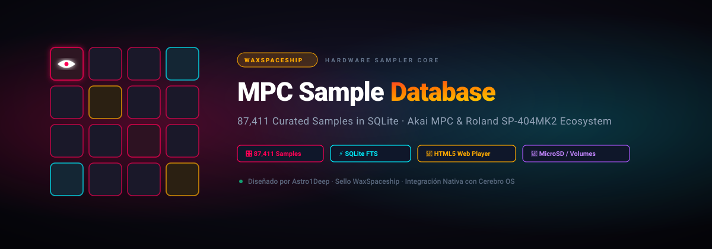

<div align="center">
  
</div>

# 🎛️ Akai MPC Sample Database & Finder Toolkit

[](https://opensource.org/licenses/MIT)
[](https://www.python.org/downloads/)
[](https://www.sqlite.org/)
[](https://www.akaipro.com/)
[](https://github.com/Astro1Deep/mpc-sample-database/wiki)

Un toolkit universal, ultraligero y autónomo en **Python 3 + SQLite + HTML5** diseñado para la comunidad de productores y beatmakers que utilizan hardware **Akai MPC Standalone** (Live, Live II, One, One+, X, X SE, Key 37, Key 61) y la serie MPC Studio / Touch.

Permite indexar automáticamente cualquier tarjeta Micro SD, unidad USB o carpeta de samples en segundos, estructurando una **base de datos SQLite relacional** y generando un **catálogo interactivo web en HTML5** con reproductor de audio protegido contra bloqueos de sandbox, filtros multidimensionales y buscador de rutas para el explorador del hardware MPC.

---

## 📚 Documentación Oficial y Wiki

Para guías detalladas, arquitectura de hardware y trucos de producción, visita la **[Wiki Oficial del Proyecto](https://github.com/Astro1Deep/mpc-sample-database/wiki)** o consulta los capítulos incluidos en el repositorio:

* **[🏠 Portada de la Wiki](docs/wiki/Home.md)**
* **[🚀 1. Instalación y Puesta en Marcha](docs/wiki/01-Instalacion-y-Puesta-en-Marcha.md)**: Requisitos, configuración y opciones del instalador.
* **[📁 2. Organización MicroSD para MPC](docs/wiki/02-Organizacion-MicroSD-para-MPC.md)**: Las 7 macro-categorías ergonómicas y purga de archivos `._*` de macOS.
* **[🎹 3. Taxonomía y Detección de Audio](docs/wiki/03-Taxonomia-y-Deteccion-de-Audio.md)**: 12 tipos de sonido, rangos BPM (Lo-Fi a DnB), clave Camelot y niveles de energía.
* **[🔍 4. Auditoría de Proyectos (.xpj)](docs/wiki/04-Auditoria-de-Proyectos-MPC-(xpj).md)**: Inspección interna JSON, verificación contra `_[ProjectData]` y estados HEALTHY.
* **[📦 5. Expansiones Oficiales Akai](docs/wiki/05-Expansiones-Oficiales-Akai.md)**: Parseo de `Expansion.xml`, kits `.xpm`, carátulas gráficas y programas.
* **[🌐 6. Catálogo Web y Audio Player](docs/wiki/06-Catalogo-Web-y-Audio-Player.md)**: Reproductor de audio con codificación de segmentos, bypass de CORS y servidor web local.
* **[📊 7. Consultas Avanzadas SQLite](docs/wiki/07-Consultas-Avanzadas-SQLite.md)**: Cheat sheet de consultas SQL para beatmakers y exportaciones.

---

## 🚀 Características Principales

1. **Base de Datos SQLite Relacional (`mpc_sample.db`)**:
   - Indexación ultrarrápida de miles de archivos de audio (`.wav`, `.aif`, `.mp3`, `.flac`).
   - Clasificación universal por tipo de sonido: `KICK`, `SNARE`, `CLAP`, `HIHAT`, `CYMBAL`, `PERCUSSION`, `BASS_808`, `KEYS_SYNTH`, `MELODIC_LOOP`, `DRUM_LOOP`, `VOCAL`, `FX`.
   - Detección automática de **Tempo (BPM)** y asignación a rangos rítmicos de producción musical (Lo-Fi, Boom Bap, Trap, House, DnB).
   - Detección de **Tonalidad Musical (Key)** y mapeo automático a la rueda **Camelot** (ej: *Dm / 7A*, *C / 8B*).
   - Estimación lógica del nivel de energía sonora (*Chill*, *Groove*, *Banger*).

2. **Auditoría de Proyectos MPC Standalone (`.xpj`)**:
   - Descomprime y analiza los proyectos `.xpj` en formato JSON interno.
   - Detecta tempo de secuencia, escala musical y todas las muestras referenciadas.
   - Comprueba automáticamente si todas las muestras existen en su carpeta `_[ProjectData]`, marcando el proyecto como `HEALTHY` o `ATTENTION`.

3. **Reconocimiento de Expansiones Oficiales MPC**:
   - Parsea los archivos `Expansion.xml` en la carpeta `/Expansions`.
   - Extrae fabricante, tipo, versión, imagen de portada y contabiliza programas (`.xpm`) y samples.

4. **Catálogo Web Interactivo en HTML5**:
   - Sin dependencias externas ni frameworks pesados (abre con doble clic).
   - Paginación dinámica (60 items por página) para soportar catálogos de 30.000+ muestras con suavidad.
   - Reproductor de audio con codificación segmento a segmento para caracteres especiales (`&`, `#`, espacios).
   - Servidor web local integrado en 1 clic (`./install.sh` opción 2) para eludir cualquier política de sandbox `file://` del navegador.
   - Botón para **copiar la ruta exacta** para cargar en los pads del MPC.

---

## 📦 Estructura del Repositorio

```text
mpc-sample-database/
├── install.sh                # Instalador interactivo para macOS y Linux
├── installer.py              # Instalador universal multiplataforma (Windows / Mac / Linux)
├── index_mpc_library.py      # Motor autónomo de indexación en Python 3 puro
├── sync_wiki.sh              # Sincronizador automatizado con GitHub Wiki
├── schema.sql                # Definición formal de la base de datos SQLite
├── catalogo_universal.html   # Plantilla HTML5 del catálogo con audio player
├── docs/
│   └── wiki/                 # Artículos completos de la Wiki Oficial
├── LICENSE                   # Licencia MIT
└── README.md                 # Documentación principal del proyecto
```

---

## ⚡ Instalación Rápida

### Opción 1: En macOS o Linux (Vía Terminal)
```bash
# 1. Clona el repositorio
git clone https://github.com/Astro1Deep/mpc-sample-database.git
cd mpc-sample-database

# 2. Da permisos de ejecución e inicia el instalador
chmod +x install.sh
./install.sh
```

El menú interactivo te permitirá:
1. Indexar tu tarjeta SD.
2. Iniciar el servidor local web para reproducir audio en cualquier navegador.
3. Purgar archivos ocultos `._*` y `.DS_Store` de macOS.
4. Inicializar base de datos vacía.
5. Abrir la Wiki oficial.

---

### Opción 2: Multiplataforma con Python (Windows, Mac, Linux)
```bash
python3 installer.py
```

---

### Opción 3: Indexación Directa desde la Línea de Comandos
```bash
python3 index_mpc_library.py --path "/Volumes/MPCSMPL"
```

El script creará automáticamente en tu tarjeta:
- `catalogo_mpc_sample.html` (en la raíz, listo para usar)
- `SQLITE_DATABASE/mpc_sample.db`
- `SQLITE_DATABASE/mpc_sample.json`
- `SQLITE_DATABASE/mpc_sample_resumen.csv`

---

## 💻 Consultas SQLite de Ejemplo

Puedes interactuar directamente con la base de datos usando `sqlite3`:

```bash
# Buscar todos los bombos (Kicks) en la librería:
sqlite3 mpc_sample.db "SELECT filename, sub_pack, size_mb FROM samples WHERE sound_type='KICK' LIMIT 10;"

# Buscar loops a 140 BPM en escala Dm (Trap / Drill):
sqlite3 mpc_sample.db "SELECT filename, sub_pack, camelot FROM samples WHERE bpm=140 AND musical_key='Dm';"

# Ver distribución de muestras por energía sonora:
sqlite3 mpc_sample.db "SELECT energy_level, count(*) FROM samples GROUP BY energy_level;"
```

---

## 🌐 English Quickstart

### What is this?
A lightweight, zero-dependency toolkit for **Akai MPC Standalone** users (MPC One, Live, X, Key) that indexes your SD card or sound library into a relational **SQLite database** and generates a **standalone interactive HTML catalog** with audio preview and path copier.

### How to use:
1. Clone this repo:
   ```bash
   git clone https://github.com/Astro1Deep/mpc-sample-database.git
   cd mpc-sample-database
   ```
2. Run the indexer pointing to your MPC SD card:
   ```bash
   python3 index_mpc_library.py --path "/path/to/your/mpc/sdcard"
   ```
3. Open `catalogo_mpc_sample.html` or run `./install.sh` (Option 2) to launch the instant local player!

---

## 📄 Licencia

Este proyecto está bajo la Licencia **MIT**. Consulta el archivo [LICENSE](LICENSE) para más detalles.
Contribuidores y productores de la comunidad MPC son bienvenidos a enviar Pull Requests y mejoras.
Desarrollado con pasión para beatmakers por [Astro1Deep](https://github.com/Astro1Deep).
