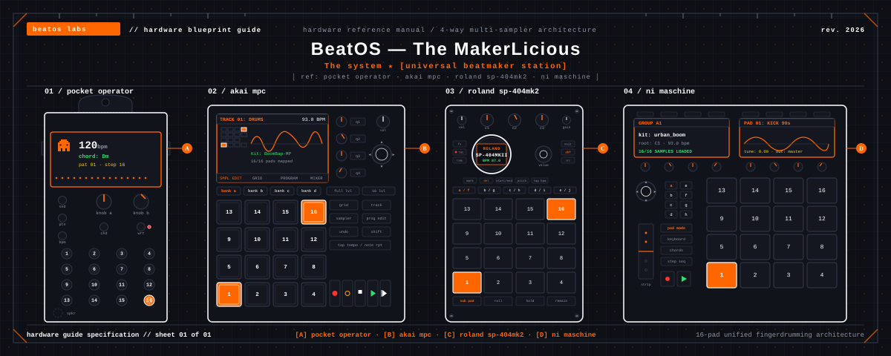

# 🎛️ BeatOS — The MakerLicious
### The system ★ [universal beatmaker station]
> `│ ref: mpc · sp-404 · po-20 · maschine // spec sheet 01 │`  
> **Universal Beatmaker Hub & Multi-Sampler Toolkit**

<p align="center">
  
</p>

[](https://opensource.org/licenses/MIT)
[](https://www.python.org/downloads/)
[](https://www.sqlite.org/)
[](https://github.com/Astro1Deep/mpc-sample-database)
[](#-temas-visuales-y-sincronizaci%C3%B3n-del-ecosistema)
[](#-bilingual-support--soporte-bilingüe)
[](https://github.com/Astro1Deep/mpc-sample-database/wiki)

Un ecosistema universal, ultraligero y autónomo en **Python 3 + SQLite + HTML5** diseñado para beatmakers y productores musicales. Permite indexar, preescuchar, auditar y diseñar drum kits para:
- **Akai MPC Standalone** (Live, Live II, One, One+, X, X SE, Key 37, Key 61, Studio)
- **Roland SP-404MK2 & DOOM OS / SP-404A / SX**
- **Native Instruments Maschine** (MK3, Plus, Mikro)
- **Teenage Engineering Pocket Operator** (PO-33 K.O.! & PO-133 Street Fighter)

---

## 🌐 Bilingual Support / Soporte Bilingüe

El catálogo web interactivo y la documentación cuentan con **soporte bilingüe instantáneo (Español / English)**:
* Pulsa el botón **`🌐 ES | EN`** en la barra superior para alternar de forma inmediata todo el entorno visual.
* La preferencia de idioma se almacena automáticamente en el navegador (`localStorage`).
* Toda la documentación de la Wiki y guías técnicas están organizadas con referencias claras en ambos idiomas.

---

## 📚 Documentación Oficial y Wiki / Official Wiki

Visita la **[Wiki Oficial en GitHub](https://github.com/Astro1Deep/mpc-sample-database/wiki)** o consulta los artículos en el repositorio:

* **[🏠 Portada de la Wiki / Home](docs/wiki/Home.md)**
* **[🚀 1. Instalación y Puesta en Marcha](docs/wiki/01-Instalacion-y-Puesta-en-Marcha.md)**: Instalador interactivo y streaming local.
* **[📁 2. Organización MicroSD para MPC](docs/wiki/02-Organizacion-MicroSD-para-MPC.md)**: Las 7 macro-categorías y purga de `._*`.
* **[🎹 3. Taxonomía y Detección de Audio](docs/wiki/03-Taxonomia-y-Deteccion-de-Audio.md)**: 12 tipos de sonido, rangos BPM y Camelot.
* **[🔍 4. Auditoría de Proyectos (.xpj)](docs/wiki/04-Auditoria-de-Proyectos-MPC-(xpj).md)**: Inspección de JSON interno y verificación `_[ProjectData]`.
* **[📦 5. Expansiones Oficiales Akai](docs/wiki/05-Expansiones-Oficiales-Akai.md)**: Parseo de `Expansion.xml`, kits `.xpm` y programas.
* **[🌐 6. Catálogo Web y Audio Player](docs/wiki/06-Catalogo-Web-y-Audio-Player.md)**: Servidor RFC 7233 Range Requests (HTTP 206).
* **[📊 7. Consultas Avanzadas SQLite](docs/wiki/07-Consultas-Avanzadas-SQLite.md)**: Cheat sheet de consultas SQL para beatmakers.
* **[🎛️ 8. Universal Beatmaker Rack](docs/wiki/08-Universal-Hardware-Beatmaker-Rack-(MPC-Maschine-SP404-PO33).md)**: Rack de 16 pads, afinación, choke groups y exportación.
* **[🕹️ 9. Pocket Operator PO-33 Studio](docs/wiki/09-Pocket-Operator-PO-33-KO-Studio-y-FSK-Modem.md)**: Drum Reels calibrados a 150 ms y módem FSK.
* **[🌐 10. Manual Bilingüe (ES / EN)](docs/wiki/10-Manual-Bilingue-y-Selector-de-Idioma-(ES-EN).md)**: Guía de internacionalización y configuración.
* **[🔌 11. Auto-Reconocimiento de Discos](docs/wiki/11-Auto-Reconocimiento-y-Onboarding-de-Discos.md)**: Diagnóstico y autoconfiguración de nuevos volúmenes.

---

## 🚀 Características Principales

1. **Universal Beatmaker Kit Rack (16 Pads)**:
   - Cuadrícula táctil e interactiva disparable por ratón o teclado físico (`Z-V`, `A-F`, `Q-R`, `1-4`).
   - **Pad Inspector Modal**: Volumen lineal, paneo estéreo, afinación (**-24 a +24 semitones**), **Choke / Mute Groups (1-8)** e intercambio de pads (Pad Swap).
   - Generación en 1 clic de programas nativos para Akai MPC (`.xpm`/`.xpj`), NI Maschine (`.mxgrp`), Roland SP-404MK2 y Pocket Operator PO-33.

2. **Pocket Operator PO-33 / PO-133 Studio**:
   - Generador de **Drum Reel** con silencios de exactamente **150 ms** para el algoritmo de Auto-Slice en los pads 9-16.
   - Control matemático estricto del presupuesto de RAM (**≤ 40.0 s**).
   - Verificador y preescucha de respaldos por audio módem **FSK (~73.6 s)**.

3. **Base de Datos SQLite Relacional (`mpc_sample.db`)**:
   - Indexación ultrarrápida de archivos `.wav`, `.aif`, `.mp3` y `.flac`.
   - Taxonomía automática: `KICK`, `SNARE`, `CLAP`, `HIHAT`, `CYMBAL`, `PERCUSSION`, `BASS_808`, `KEYS_SYNTH`, `MELODIC_LOOP`, `DRUM_LOOP`, `VOCAL`, `FX`.
   - Estimación de tonalidad musical, rueda Camelot y nivel de energía (*Chill*, *Groove*, *Banger*).

4. **Servidor de Audio Streaming de Alto Rendimiento (`serve_mpc.py`)**:
   - Soporte completo para **RFC 7233 Range Requests (HTTP 206 Partial Content)** y CORS.
   - Reproducción sin bloqueos en Safari, Chrome, Firefox y WebKit.
   - API REST completa para tareas de reindexación, limpieza y creación de kits.

5. **🎨 Temas Visuales y Sincronización del Ecosistema**:
   - Alternancia en caliente entre **5 estéticas visuales de hardware**:
     - 🕹️ **Teenage Engineering PO-20 Arcade**: Placa PCB negro mate, serigrafía técnica suiza blanca y acentos naranja arcade.
     - ⚡ **Cerebro OS Neon**: Cian y magenta reactivo de alta energía sobre fondo medianoche.
     - 🎛️ **Akai MPC Vintage**: MPC 60 / 2000XL con chasis gris piedra y acentos rojos legendarios.
     - 🎚️ **Roland SP-404MK2**: Glow cálido ámbar sobre vinilo negro y acentos DJFX.
     - 🎹 **NI Maschine Studio**: Carbón anodizado y retroiluminación RGB de pads.
   - **Sincronización global bidireccional**: Vía API REST (`/api/theme`) y persistencia en `ecosystem_theme.json` para unificar el estilo visual en todo Cerebro OS y herramientas de producción.

---

## ⚡ Instalación Rápida

### En macOS o Linux
```bash
# 1. Clona el repositorio
git clone https://github.com/Astro1Deep/mpc-sample-database.git
cd mpc-sample-database

# 2. Concede permisos e inicia el instalador interactivo
chmod +x install.sh
./install.sh
```

El menú interactivo te permite:
1. Indexar cualquier tarjeta SD o carpeta local.
2. Iniciar el servidor local de audio streaming (`http://localhost:8888`).
3. Purgar archivos residuales `._*` y `.DS_Store`.
4. Sincronizar la documentación con GitHub Wiki.

---

## 📦 Estructura del Repositorio

```text
mpc-sample-database/
├── catalogo_universal.html   # Catálogo interactivo web HTML5 bilingüe (ES/EN)
├── hardware_kit_builder.py   # Motor multi-sampler universal (MPC, SP404, Maschine, PO-33)
├── serve_mpc.py              # Servidor HTTP RFC 7233 con API REST y streaming parcial
├── index_mpc_library.py      # Motor autónomo de indexación en Python 3 puro
├── install.sh                # Instalador interactivo para macOS y Linux
├── installer.py              # Instalador multiplataforma (Windows / Mac / Linux)
├── sync_wiki.sh              # Sincronizador automatizado con GitHub Wiki
├── schema.sql                # Esquema relacional formal SQLite
├── language_config.json      # Configuración de localización bilingüe
├── docs/
│   └── wiki/                 # Los 11 artículos técnicos completos de la Wiki
├── LICENSE                   # Licencia MIT
└── README.md                 # Documentación principal bilingüe
```
