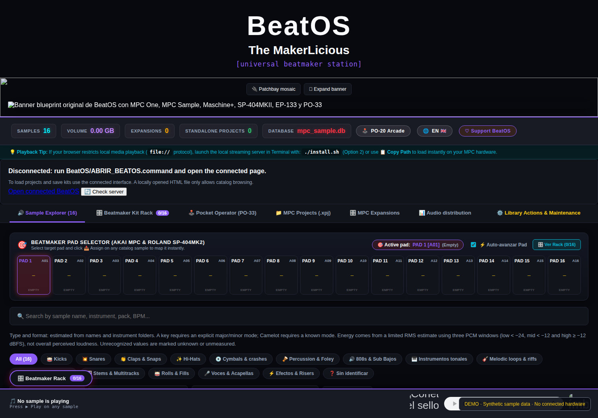
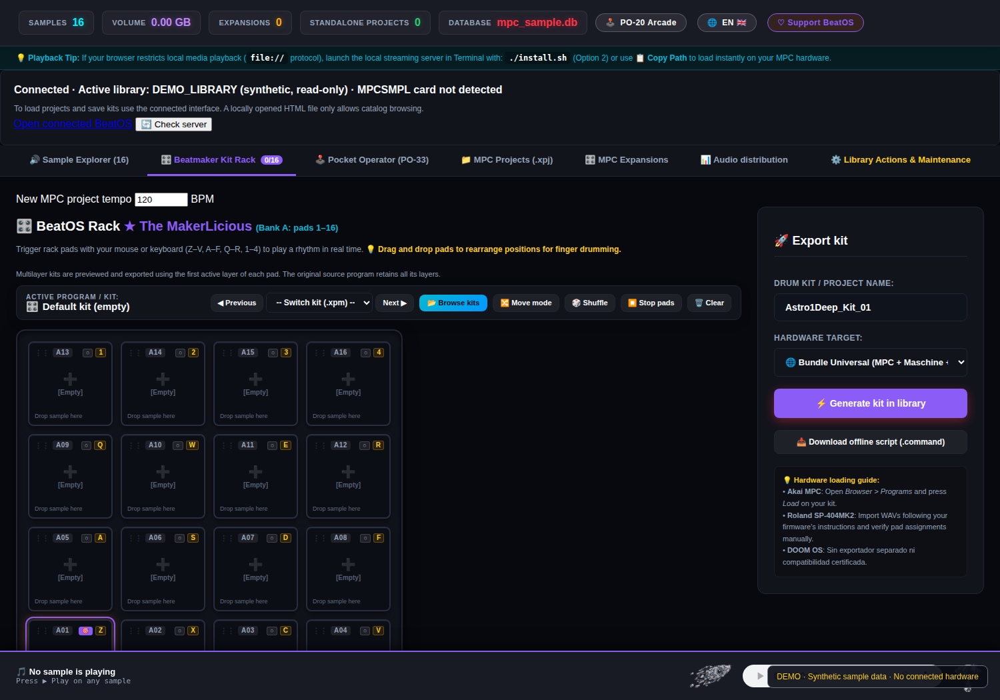
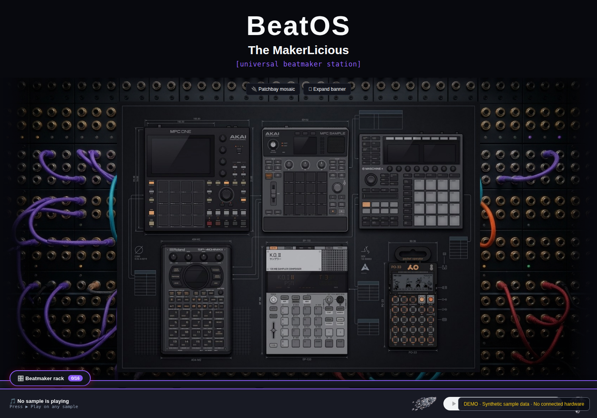
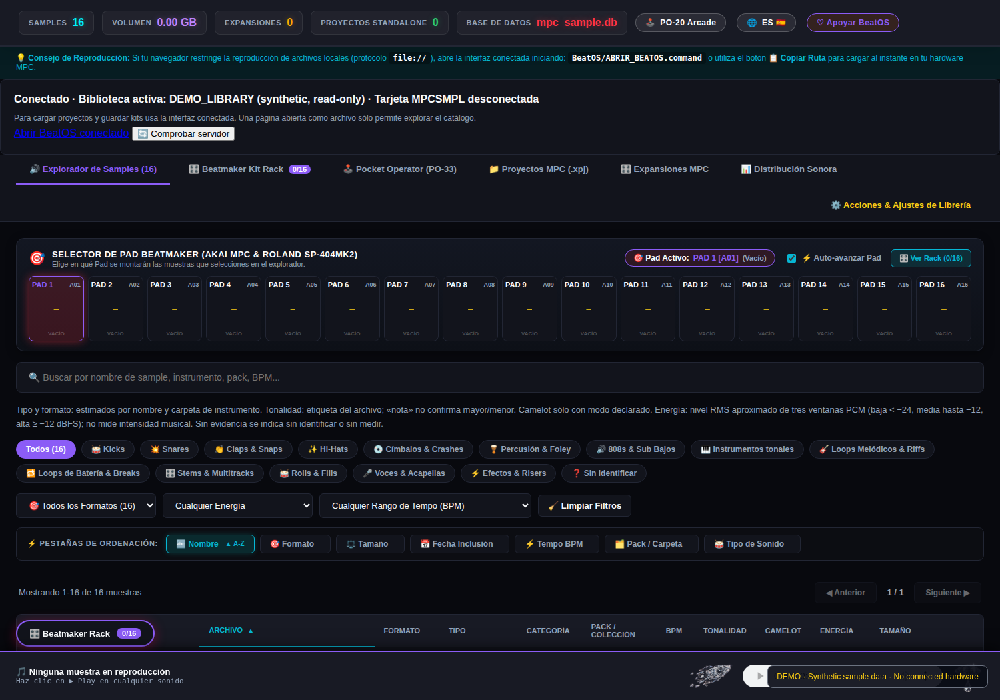

<p align="center"></p>

# BeatOS — The MakerLicious
**Local sample browser · 16-pad beatmaking rack · hardware-oriented kit exports**

**Language: English (default) · [Español / Spanish README](README_ES.md)**

BeatOS is a local, open-source sample-library browser and kit-preparation workstation for producers, beatmakers and audio engineers. It helps you audition and classify audio, assemble a 16-pad rack, inspect supported Akai MPC projects and prepare sampler-specific deliveries. It does **not** replace hardware firmware, turn every sampler into a fully native project editor, or guarantee playback on every hardware/firmware combination.



<details><summary>Additional real screenshots: rack, hero and Spanish interface</summary>







</details>

## Quick start

**Requirements:** Python 3.11+, a local sample-library folder, a desktop browser. FFmpeg is recommended and required for format conversion, resampling and some pitch operations. No commercial samples or private libraries are included.

1. Download the **release asset** `BeatOS-3.8.0.zip` from [GitHub Releases](https://github.com/Astro1Deep/BeatOS-TheMakerLicious/releases/latest), not GitHub's automatic *Source code* ZIP. Verify the published SHA-256.
2. Extract into a new folder. Do not overwrite an existing sample library.
3. Run the installer, select **1** to index your sample library, and **2** to open its local web interface.

```bash
# Inside the extracted release parent directory:
python3 BeatOS/installer.py

# Windows:
py BeatOS/installer.py
```

For a source checkout, the entry point is `python3 installer.py` from the repository root. To reindex and launch the server explicitly:

```bash
python3 BeatOS/index_mpc_library.py --path "/path/to/Your Samples"
python3 BeatOS/serve_mpc.py "/path/to/Your Samples" --port 8888
```

**Localization:** English is the first-run default for the UI, installer, indexer and local API; switch to **ES** in the web header or use `--lang es` / `BEATOS_LANG=es` for command-line tools. The browser remembers your explicit selection. The locale changes UI text and diagnostic messages, **never** your sample filenames, project titles, paths or audio payloads.

> **Release notice:** the latest stable release asset may predate changes on `main`. A passing CI build is not a published stable installer. Current source fixes require a new release, and existing installed libraries must be reindexed after upgrading the application. [Review the current QA status](docs/AUDITORIA_INTEGRAL_BILINGUE_2026-10-30.md).

## Hardware/export matrix

| Destination | BeatOS output | What you load | Native-equivalence limits |
| --- | --- | --- | --- |
| **Akai MPC** | Drum `.xpm`; Sample-derived `.xpj` and project data; WAV | Compatible MPC Drum program or project, according to model and firmware | Sample/AC50-derived XPJ is **not** a verified universal One/Live/X project. Validate on the target engine. |
| **NI Maschine** | WAV files and a BeatOS `*_Maschine_Map.json` | Import WAV files and map the pads in Maschine | **Not** an `.mxgrp` project; JSON is guidance, not an auto-import format. |
| **Roland SP-404MKII** | 16 pad-labelled PCM WAVs (16-bit/48 kHz), JSON manifest | Import WAVs via a supported transfer workflow | No native SP-404MKII backup/project is generated; pad settings may require manual configuration. |
| **Roland SP-404A / SX** | 12 pad-labelled PCM WAVs (16-bit/44.1 kHz) | Import WAV samples into a suitable bank | Not a native SP-404 backup/pattern. The first 12 source pads are used. |
| **PO-33 / PO-133** | Mono PCM WAV drum reel (44.1 kHz), slice timing JSON | Record the played reel over audio input and review slices | Not a modem backup or restorable pattern file. Budget must match actual free memory. |
| **EP-133 K.O. II** | PCM WAVs (16-bit/44.1 kHz), `meta.json`, transport ZIP | Extract WAVs, transfer through supported Sample Tool workflow, configure assignments | Transport ZIP is **not** a native backup. Metadata does not automatically assign every parameter. |

Consult the [advanced per-device export and validation guide](docs/en/HARDWARE_EXPORT_PROTOCOLS.md) before using a kit on hardware. It explains sample-rate conversion, instrument mapping, path references, channel layout, what remains manual, and device-by-device acceptance checks.

## Documentation

| Subject | English | Español |
| --- | --- | --- |
| First installation | [Installation guide](GUIA_INSTALACION_EN.md) | [Guía de instalación](GUIA_INSTALACION.md) |
| Complete operator manual | [20-chapter manual](docs/en/MANUAL_COMPLETO.md) | [Manual de 20 capítulos](docs/MANUAL_COMPLETO.md) |
| Detailed hardware workflows | [Export protocols and validation](docs/en/HARDWARE_EXPORT_PROTOCOLS.md) | [Protocolos y validación](docs/HARDWARE_EXPORT_PROTOCOLS.md) |
| Compatibility and limitations | [Device compatibility](docs/en/COMPATIBILIDAD_HARDWARE.md) | [Compatibilidad de hardware](docs/COMPATIBILIDAD_HARDWARE.md) |
| Indexing, SQLite and HTTP API | [Technical reference](docs/en/REFERENCIA_TECNICA.md) | [Referencia técnica](docs/REFERENCIA_TECNICA.md) |
| Topic-by-topic Wiki | [English wiki](docs/wiki/Home_EN.md) | [Wiki en español](docs/wiki/Home.md) |

## Reliability and safety

BeatOS uses local HTTP streaming, supports ranged audio requests, and builds kits in the user's selected library. Keep the server on localhost: its APIs have no remote-user authentication. Do not expose it to the internet or load untrusted project files without inspecting them. Retain your original samples and hardware backups; exporting or reindexing must not be treated as a verified hardware backup.

Automated CI checks include Python regression tests, Node UI logic, a real browser ES/EN smoke test, a clean installer archive, and Windows installation smoke tests. These verify **software behavior and structural file properties**, not physical sample recall or pattern fidelity on every device. Hardware verification requires model, firmware, media type and a recorded load/listen/save/reload cycle.

## Project identity and discovery

Created by [Astro1Deep](https://github.com/Astro1Deep) · [GitHub repository](https://github.com/Astro1Deep/BeatOS-TheMakerLicious) · [Latest stable releases](https://github.com/Astro1Deep/BeatOS-TheMakerLicious/releases) · [English website source](docs/index.html) · [Sitio en español](docs/index-es.html).

Relevant repository topics: `beatmaking`, `sample-library`, `akai-mpc`, `maschine`, `sp-404`, `po-33`, `ep-133`, `drum-kits`, `music-production`. GitHub repository **Topics** affect repository discovery; Markdown hashtags do not substitute for configured topics. GitHub Pages must be enabled before treating the website as live.

**Version documented:** stable 3.8.0. Check `VERSION`, the build manifest and release checksums for the actual installed artifact.
