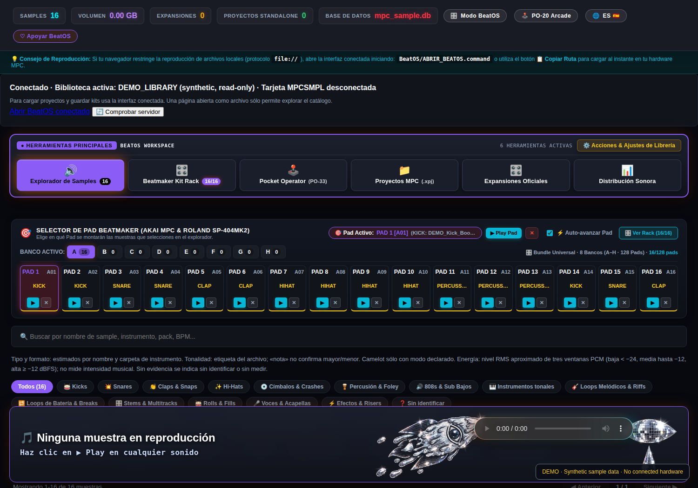
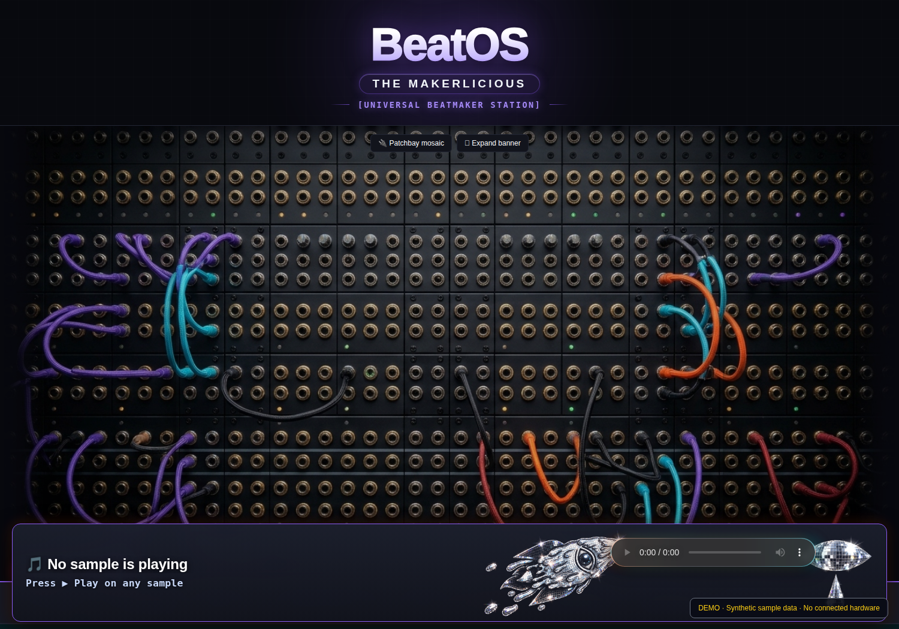

<p align="center"></p>

# BeatOS — The MakerLicious
**Explorador local de samples · rack de 16 pads · exportación orientada a hardware**

**Idioma: Español · [English / presentación principal](README.md)**

BeatOS es una estación de preparación de kits para músicos, beatmakers y productores musicales. Permite explorar y preescuchar bibliotecas, organizar samples, editar un rack de 16 pads, inspeccionar ciertos proyectos MPC y generar entregas adaptadas a distintos samplers. **No sustituye el firmware** ni convierte automáticamente todos los kits en proyectos nativos de cada máquina.



<details><summary>Otras capturas reales de la interfaz</summary>




</details>

## Instalación

Necesitas Python 3.11 o posterior, un navegador de escritorio y una carpeta de samples propia. FFmpeg es recomendable y obligatorio para determinadas conversiones de audio y frecuencia.

1. Descarga el **archivo adjunto a la versión estable** desde [Versiones publicadas](https://github.com/Astro1Deep/BeatOS-TheMakerLicious/releases/latest) y verifica el SHA-256. No confundas el ZIP del instalador con el ZIP automático del código fuente.
2. Descomprime en una carpeta nueva, sin sobrescribir bibliotecas existentes.
3. Abre una terminal desde la carpeta contenedora de `BeatOS/` y ejecuta:

```bash
python3 BeatOS/installer.py --lang es
# En Windows:
py BeatOS/installer.py --lang es
```

Utiliza la opción **1** para indexar y **2** para abrir el servidor local. En un clon del repositorio, ejecuta `python3 installer.py --lang es` desde su raíz.

**Idiomas:** por defecto, el primer inicio se muestra en inglés. Puedes seleccionar **ES** desde el encabezado web. La preferencia se conserva en el navegador; para terminal, utiliza `--lang es` o `BEATOS_LANG=es`. Ni los nombres de archivos, ni las rutas, ni los nombres de proyectos privados se traducen.

> **Importante:** el código de `main` puede ser más reciente que el instalador estable 3.9.0. Para actualizar una instalación, instala una distribución nueva y regenera el catálogo de tu biblioteca tras conservar tus copias. [Estado de la auditoría](docs/AUDITORIA_INTEGRAL_BILINGUE_2026-10-30.md).

## Formatos y límites por hardware

| Sistema | Exportación de BeatOS | Limitación esencial |
| --- | --- | --- |
| **Akai MPC Standalone & SampQOL OS** | Programa Drum `.xpm`, proyecto `.xpj` (1 pista o 4 buses submix), Expansión oficial (`Expansion.xml` + `.xpansion.zip`), editor `/mpcqol.conf` | El proyecto Sample/AC50 no equivale automáticamente al formato nativo de MPC One/Live/X. |
| **Akai MPC 1000 / 2500 / 500 (JJOS) & MPC 2000 / 2000XL** | `.PGM` binario + WAV PCM 16-bit/44.1 kHz (nombres DOS 8.3 en 2000/2000XL) | Exportación orientada a programas de batería estándar; verifica la carga en tu máquina real. |
| **NI Maschine** | WAV y mapa JSON de asignaciones | No genera un `.mxgrp` nativo; hay que realizar la asignación en Maschine. |
| **Roland SP-404MKII** | WAV PCM 16-bit/48 kHz para hasta 16 pads; manifiesto JSON | No genera copia nativa de proyecto o patrones; requiere importación. |
| **Roland SP-404A/SX** | WAV PCM 16-bit/44.1 kHz, pads A01–A12 | No es un backup nativo y se limita a 12 pads de un banco. |
| **PO-33/PO-133** | Reel de batería mono 44.1 kHz con mapa de cortes y archivo FSK local | Se graba por audio y se revisa en TRIM; el reel WAV no sustituye al backup módem. |
| **EP-133 K.O. II** | WAV 16-bit/44.1 kHz, `meta.json` y ZIP | El ZIP solo transporta archivos; no es un backup restaurable del aparato. |

## Capacidades clave para beatmakers y samplers hardware

- **Akai MPC Standalone & SampQOL OS v0.2.0:** Lectura y edición `.xpm`/`.xpj`, constructor de Expansiones oficiales MPC (`Expansion.xml` + previews + `.xpansion.zip`), gestor seguro de `/mpcqol.conf` con copias de respaldo y ruteo Multi-Track de 4 buses submix.
- **MPC clásicas (Legacy `.PGM`):** Exportación binaria compatible con **MPC 1000 / 2500 / 500 (JJOS)** y **MPC 2000 / 2000XL** en PCM 16-bit/44.1 kHz.
- **Motor DSP Cerebro OS para Crate-Digging:** Análisis espectral PCM en 3 bandas (`Sub / Calidez Media / Aire`), detección de compás (`4/4`, `3/4`, `6/8`, `5/4`), clave latina y swing (`Bolero`, `Soul`, `Jazz`, `Bossa/Samba`, `Cumbia/Son`, `Tango/Vals`, `Drumless`, `Psych` y géneros club), adaptación multi-perfil a Hip-Hop / Boom Bap / Lo-Fi, Auto-Chop inteligente con puente `3/4→4/4` y ajuste tonal de 808.
- **Generador Cromático MPCTK y Rack de 8 Bancos (128 Pads):** Despliega muestras en 16 notas de escala, preescucha con simulación real de Mute Groups y exporta hacia tu hardware.

**Generar un archivo no equivale a verificar su carga.** Consulta las guías para comprobar nombres, parámetros PCM, referencias, límites de memoria, mapeo de pads y reproducción en hardware real.

## Manuales y documentación

| Materia | Español | Inglés |
| --- | --- | --- |
| Instalación | [Guía de instalación](GUIA_INSTALACION.md) | [Installation guide](GUIA_INSTALACION_EN.md) |
| Uso completo | [Manual de 20 capítulos](docs/MANUAL_COMPLETO.md) | [Complete manual](docs/en/MANUAL_COMPLETO.md) |
| Protocolos de exportación | [Guía avanzada y validación](docs/HARDWARE_EXPORT_PROTOCOLS.md) | [Advanced export protocols](docs/en/HARDWARE_EXPORT_PROTOCOLS.md) |
| Modelos y limitaciones | [Compatibilidad](docs/COMPATIBILIDAD_HARDWARE.md) | [Compatibility](docs/en/COMPATIBILIDAD_HARDWARE.md) |
| API, SQLite y CLI | [Referencia técnica](docs/REFERENCIA_TECNICA.md) | [Technical reference](docs/en/REFERENCIA_TECNICA.md) |
| Temas específicos | [Wiki en español](docs/wiki/Home.md) | [English Wiki](docs/wiki/Home_EN.md) |

## Seguridad y pruebas

El servidor se utiliza **en local**, sin autenticación de usuarios remotos: no publiques su puerto en Internet. Conserva los WAV de origen, proyectos originales y copias de seguridad del hardware. Las pruebas automáticas verifican integridad, estructura, API e interacción web, pero la fidelidad final exige cargar, reproducir, guardar y volver a abrir el kit en el modelo y firmware concretos.

**Autoría:** [Astro1Deep](https://github.com/Astro1Deep) · [Repositorio](https://github.com/Astro1Deep/BeatOS-TheMakerLicious) · [Versiones estables](https://github.com/Astro1Deep/BeatOS-TheMakerLicious/releases) · [Web oficial (ES)](https://astro1deep.github.io/BeatOS-TheMakerLicious/index-es.html) · [Kit de difusión, redes y desarrolladores](docs/KIT_DIFUSION_Y_COMUNIDAD.md).

**Versión estable documentada:** 3.9.0 (la rama `main` incluye además el motor rítmico DSP Cerebro OS, gestor SampQOL OS, exportación binaria `.PGM` y creador de Expansiones MPC). Comprueba siempre el manifiesto y la suma SHA-256 de la descarga concreta.
