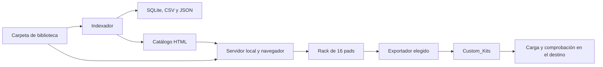

# Manual completo de BeatOS · The MakerLicious

**[universal beatmaker station] · Versión del sistema: 3.8.0 · Revisión del manual: 30 de octubre de 2026.**

BeatOS prepara bibliotecas y kits en el ordenador para varios samplers y entornos de producción. Este manual describe el comportamiento del código actual y los pasos para usar cada módulo. Los nombres históricos `mpc_sample`, `serve_mpc.py` y «Tarjeta MicroSD» no limitan el sistema a MPC ni obligan a usar una tarjeta.

Para elegir cómo cargar una entrega, consulta la [compatibilidad por modelo y firmware](COMPATIBILIDAD_HARDWARE.md). Para comandos, datos y API, consulta la [referencia técnica](REFERENCIA_TECNICA.md). [Volver a la presentación](../README.md).

## Índice de uso

1. [Qué hace el sistema](#1-qué-hace-el-sistema)
2. [Instalación y primer arranque](#2-instalación-y-primer-arranque)
3. [Bibliotecas, rutas y archivos](#3-bibliotecas-rutas-y-archivos)
4. [Indexación e identificación](#4-indexación-e-identificación)
5. [Explorador de samples](#5-explorador-de-samples)
6. [Reproductor y escucha](#6-reproductor-y-escucha)
7. [Rack de 16 pads](#7-rack-de-16-pads)
8. [Proyectos MPC](#8-proyectos-mpc)
9. [Expansiones](#9-expansiones)
10. [Exportación](#10-exportación)
11. [Hub PO-33 y PO-133](#11-hub-po-33-y-po-133)
12. [Respaldos PO](#12-respaldos-po)
13. [Hub EP-133](#13-hub-ep-133)
14. [Distribución sonora](#14-distribución-sonora)
15. [Acciones y ajustes](#15-acciones-y-ajustes)
16. [Temas, idiomas y apoyo](#16-temas-idiomas-y-apoyo)
17. [Conservar y trasladar el trabajo](#17-conservar-y-trasladar-el-trabajo)
18. [Recorridos completos](#18-recorridos-completos)
19. [Diagnóstico](#19-diagnóstico)
20. [Alcance de las verificaciones](#20-alcance-de-las-verificaciones)

## 1. Qué hace el sistema

El recorrido normal es **carpeta de samples → indexación → búsqueda y escucha → rack → exportación → carga y comprobación en el destino**. Puedes comenzar con WAV sueltos sin tener una MPC ni proyectos Akai.



| Módulo | Para qué sirve | Resultado |
| --- | --- | --- |
| Instalador | Elegir biblioteca, indexar, arrancar y acceder a operaciones locales. | Código ejecutándose en el ordenador. |
| Indexador | Recorrer archivos y crear un índice consultable. | SQLite, CSV, resumen JSON y catálogo HTML. |
| Explorador | Buscar, filtrar, escuchar y asignar samples. | Selección para los pads. |
| Reproductor | Escuchar archivos y pads con los ajustes disponibles. | Monitorización local; no reproduce una canción MPC completa. |
| Rack | Preparar hasta 16 posiciones de un kit. | Copia de trabajo con parámetros por pad. |
| Proyectos | Localizar XPJ e importar una pista Drum y un banco. | Copia simplificada en el rack. |
| Expansiones | Explorar paquetes, programas, proyectos y muestras. | Acceso al material disponible en tu biblioteca. |
| Exportadores | Adaptar el kit a seis destinos o al conjunto universal. | Archivos en `Custom_Kits/`. |
| Hub Teenage Engineering | Preparar reel PO, capturar/importar/archivar respaldos WAV, preparar su reproducción de restauración o generar entrega EP. | Audio, archivo de respaldos y mapas de intercambio. |
| Distribución sonora | Consultar la composición del índice. | Resúmenes por formato, tipo, categoría, nivel y BPM. |
| Mantenimiento | Reindexar, limpiar auxiliares o consultar el servidor. | Índice actualizado y operaciones expresamente solicitadas. |

BeatOS no es firmware, un DAW, un motor de plugins, un secuenciador completo ni una herramienta de restauración universal. Una vista de proyecto muestra referencias y permite preparar un kit; no interpreta todas las funciones de su máquina de origen. Los controles del navegador tampoco constituyen una conexión MIDI directa con todos los aparatos.

## 2. Instalación y primer arranque

### Requisitos

- Python **3.11 o superior** para indexación, servidor y exportadores. El núcleo usa la biblioteca estándar.
- Carpeta de biblioteca accesible con permisos de lectura y escritura. El índice y los kits necesitan espacio libre en esa ubicación.
- Navegador con audio para trabajar con el catálogo conectado. Los códecs disponibles varían entre navegadores.
- **FFmpeg** en el PATH del proceso de Python para convertir formatos/frecuencias/profundidades incompatibles o afinar el reel PO. Poder escuchar un MP3 en el navegador no significa que Python pueda convertirlo sin FFmpeg.
- Node.js sólo para las pruebas JavaScript de desarrollo; no es necesario para producir kits desde la aplicación.

### Desde el ZIP de distribución

Descarga el adjunto BeatOS de [Releases](https://github.com/Astro1Deep/mpc-sample-database/releases/latest), no confundas el instalador organizado con «Source code». Extrae en una carpeta nueva y entra en la carpeta extraída que contiene `BeatOS/`. Ejecuta:

```bash
python3 BeatOS/installer.py
```

En Windows usa `py BeatOS/installer.py`. En macOS/Linux puedes ejecutar `./BeatOS/install.sh`. El lanzador macOS `BeatOS/ABRIR_BEATOS.command` abre el servidor; primero indexa la biblioteca.

### Desde un clon del repositorio

Los scripts están en la raíz del clon. Desde esa carpeta:

```bash
python3 installer.py
```

Para elegir explícitamente una biblioteca separada de la instalación:

```bash
python3 index_mpc_library.py --path "/ruta/a/Mis Samples"
python3 serve_mpc.py "/ruta/a/Mis Samples" --port 8888
```

En el ZIP, antepón `BeatOS/` a esos dos nombres de script. En Windows sustituye `python3` por `py`. Conserva las comillas de las rutas con espacios.

### Opciones del instalador

| Opción | Comportamiento | Qué comprobar |
| --- | --- | --- |
| 1 · Indexar | Pide una ruta, genera el índice y puede abrir el servidor para esa biblioteca. | Indica la carpeta que realmente contiene tus samples. |
| 2 · Servidor | Pide la biblioteca y abre su URL local. | Usa la misma ruta que al indexar. |
| 3 · Limpiar | Elimina `._*` y `.DS_Store` de la ruta indicada. | Es una acción destructiva de auxiliares; no es necesaria para arrancar. |
| 4 · SQLite | Ejecuta el esquema en la ubicación predeterminada de la instalación. | No pide otra biblioteca, no escanea muestras y no es un comando de borrado/reinicio del catálogo. |
| 5 · Wiki | Abre la wiki de GitHub. | Los manuales versionados de esta entrega están también en `docs/`. |
| 6 · Salir | Termina el instalador. | Una opción se ejecuta por invocación; vuelve a abrirlo para otra operación. |

### Confirmar el arranque

Abre la URL impresa, normalmente `http://127.0.0.1:8888/…`. Comprueba «Biblioteca activa» antes de trabajar. Si el puerto está ocupado, el programa puede elegir otro; si ya hay una instancia para la misma biblioteca en el puerto solicitado, puede reutilizarla. No deduzcas la biblioteca a partir del puerto.

Mantén la terminal del servidor abierta. `Ctrl+C` lo detiene. Expulsar una tarjeta mientras sirve archivos o genera un kit puede interrumpir la operación.

Un HTML abierto por `file://` puede mostrar datos del catálogo, pero no habilita las acciones locales del servidor. Para importar, generar kits, reindexar o consultar backups utiliza la vista HTTP conectada. Los permisos de entrada de audio PO se solicitan al detectar o grabar, no por abrir el menú. La herramienta EP del fabricante es otra página y puede requerir Internet y permisos de navegador.

## 3. Bibliotecas, rutas y archivos

Distingue **instalación** (scripts, plantilla y recursos), **biblioteca** (tu audio y proyectos), **índice** (datos generados) y **entregas** (kits nuevos). La biblioteca puede estar en un disco, una tarjeta o una carpeta independiente del código.

```text
MiBiblioteca/
  catalogo_universal.html          acceso al catálogo
  catalogo_mpc_sample.html         acceso alternativo al mismo catálogo
  BeatOS/
    data/
      catalogo.html               catálogo completo generado
      mpc_sample.db               índice SQLite
      mpc_sample_resumen.csv      tabla de muestras exportada
      mpc_sample.json             resumen y metadatos del catálogo
    config/
      theme_config.json           si se ha guardado un tema desde el servidor
  Samples/                        ejemplo de tus carpetas, nombre libre
  Expansions/                     ubicación usada para explorar programas de paquetes
  Projects/                       ejemplo para organizar XPJ
  Custom_Kits/                     kits creados por BeatOS
```

En el ZIP organizado, `BeatOS/` contiene además los scripts y recursos. Si el código está separado, esos archivos no se copian a cada biblioteca: el servidor usa recursos de la instalación y el estado de la raíz elegida.

Los dos HTML de acceso no duplican la biblioteca ni el catálogo completo. La reindexación conserva las rutas del audio; no reorganiza, renombra ni copia todos tus samples. Los directorios históricos SQLite pueden seguir existiendo; la aplicación lee algunas rutas anteriores, pero genera el estado actual en `BeatOS/data/` por defecto.

No uses como raíz una carpeta con datos que no quieras disponibles en la vista local. El servidor protege rutas privadas y `BeatOS/` salvo recursos expresamente servidos, pero su propósito es acceder a los medios de la biblioteca. Los catálogos y resúmenes generados pueden contener nombres y rutas personales: no son un paquete público para compartir sin revisar.

## 4. Indexación e identificación

### Qué se recorre y qué se escribe

El indexador busca audio `.wav`, `.aif`, `.aiff`, `.mp3` y `.flac`; convierte la extensión a minúsculas para clasificarla. La detección de proyectos busca `.xpj`. Los paquetes se reconocen por `Expansion.xml` y sus programas/muestras se cuentan por las extensiones implementadas.

Se omiten archivos/carpetas ocultos y ubicaciones de respaldo, plantillas e instalación previstas por el código. El explorador general omite rutas `_[ProjectData]` para no duplicar muestras de proyectos; esos archivos pueden seguir resolviéndose desde el importador de proyectos. Un audio ausente del explorador no implica siempre que el parser de su proyecto no pueda encontrarlo.

`Custom_Kits/` no está excluido del recorrido general: una reindexación puede incorporar tus propias entregas al catálogo y sus XPJ a la lista de proyectos. Evita confundirlos con las fuentes originales al contar muestras o comparar bibliotecas.

Reindexar reconstruye las filas de samples, proyectos, expansiones y packs. No uses sus IDs como identificadores permanentes ni guardes anotaciones manuales en esas tablas esperando que se conserven. El CSV y el JSON se regeneran; el catálogo nuevo se escribe después de construir el índice. La operación completa no es una transacción única entre todos esos archivos: si se interrumpe, reindexa de nuevo y recarga la página.

### Tipo de sonido y formato musical

El **tipo** distingue KICK, SNARE, CLAP, HIHAT, CYMBAL, PERCUSSION, BASS_808, KEYS_SYNTH, MELODIC_LOOP, DRUM_LOOP, VOCAL, FX, STEM, ROLL_FILL y UNKNOWN. El nombre del archivo tiene prioridad; después se consultan carpetas concretas de instrumento. Nombres amplios de géneros o colecciones no bastan para inventar un instrumento.

El **formato musical** distingue ONE_SHOT, LOOP, STEM, ROLL_FILL y UNSPECIFIED. No es la extensión o códec. Un archivo puede ser WAV, tipo BASS_808 y formato UNSPECIFIED a la vez. Estas etiquetas proceden de reglas de texto; BeatOS no escucha el audio con un modelo de IA.

Las heurísticas al importar un kit y las del indexador son distintas; un nombre ambiguo puede tener un tipo distinto en el rack. Escucha y revisa especialmente las asignaciones y mutes automáticos.

### Tempo, tonalidad y Camelot

El BPM se extrae de patrones del nombre dentro del rango **55–190**; no se estima del sonido. Fuera de ese rango o sin etiqueta reconocida queda sin declarar. Los rangos de navegación son <85, 85–98, 99–118, 119–132, 133–155 y >155. En algunos filtros, si falta BPM, la interfaz usa palabras de estilo como aproximación; eso no mide el tempo.

La clave usa notas con modo explícito, como `Dm`, `F#min` o `Cmajor`. Una nota de multisample como `C1` se muestra como nota sin deducir mayor o menor. Camelot sólo se calcula para una tonalidad reconocida con modo. Un nombre «Kit A» no declara La mayor.

### Qué significa energía

Se estima RMS de hasta tres ventanas de 4096 frames: inicio, centro y final de WAV PCM entero de 8/16/24/32 bits y hasta ocho canales. El resultado describe nivel de esas ventanas, no LUFS, pico verdadero, género o intensidad musical de todo el archivo.

| Valor guardado | Significado |
| --- | --- |
| `CHILL` | Nivel estimado inferior a −24 dBFS. |
| `GROOVE` | Desde −24 hasta menos de −12 dBFS. |
| `BANGER` | Desde −12 dBFS. |
| `SILENT` | Las ventanas leídas contienen silencio. |
| `UNMEASURED` | Formato, datos o cabecera no medibles con ese lector. |

Reindexar no normaliza el audio para obtener esas etiquetas. Un archivo UNMEASURED puede sonar correctamente en el navegador o convertirse con FFmpeg.

## 5. Explorador de samples

1. Abre «Explorador de Samples». Escribe varias palabras para exigir que todas aparezcan en el texto consultable: nombre, categorías, pack, tipo, formato, BPM, clave o Camelot.
2. Combina tipo, formato musical, energía y rango de BPM. Si no aparece un archivo, quita filtros y revisa también si hay un filtro de expansión activo.
3. Ordena por nombre, formato, tamaño, BPM, pack o categoría; vuelve a pulsar para invertir el orden. La opción de fecha usa el orden/ID del índice, no una fecha de modificación real leída del archivo.
4. Navega por páginas de hasta 60 muestras. Filtrar vuelve a la primera página.
5. Preescucha antes de asignar. Copiar ruta no mueve el archivo. Mostrar en el explorador del sistema requiere servidor y abre la ubicación admitida dentro de la biblioteca.
6. Selecciona el pad objetivo en la matriz o abre el selector de pads de la fila. Asignar a una posición ocupada sustituye esa posición de la copia del rack; el archivo original permanece en disco.

El avance automático busca un pad libre tras la asignación; si no queda ninguno puede seleccionar una posición ocupada. Comprueba el objetivo antes de añadir el siguiente sonido. El contador 16/16 no es una prohibición de reemplazar pads.

## 6. Reproductor y escucha

La barra de reproducción muestra nombre y ruta del archivo activo. La preescucha del explorador reproduce el archivo; los pads tienen su propia reproducción con volumen, tono, panorama si está disponible Web Audio y grupos de mute. No confundas escuchar la muestra original con escuchar todos los ajustes del pad.

El navegador debe admitir el códec. Si bloquea el inicio de audio, pulsa un control de reproducción. Un error de decodificación del navegador y un error de conversión de FFmpeg son problemas distintos; uno puede ocurrir sin el otro.

El tono del pad cambia la velocidad por `2^(semitonos/12)`: cambia también la duración, sin estirar el tiempo para conservarla. El panorama usa Web Audio cuando está disponible. «Detener pads» corta las voces del rack. No hay una emulación del mezclador, filtros, efectos o secuencias del sampler.

Empieza con volumen de escucha moderado, especialmente al pasar de preescucha original a un reel normalizado. La salida física del ordenador/interfaz condiciona el nivel que entra en un PO.

## 7. Rack de 16 pads

### Asignar, mover y tocar

El rack contiene hasta 16 muestras. Puedes asignarlas desde el explorador, arrastrarlas, importar una copia de un kit o usar Shuffle. El editor y el modo Mover permiten intercambiar dos posiciones, incluidas posiciones vacías. Vaciar un pad elimina su asignación de trabajo; «Vaciar» borra el rack y su vínculo con el origen, no los archivos de disco.

| Pads | Teclas del ordenador |
| --- | --- |
| 1–4 | Z · X · C · V |
| 5–8 | A · S · D · F |
| 9–12 | Q · W · E · R |
| 13–16 | 1 · 2 · 3 · 4 |

Las teclas no deben usarse mientras escribes en un campo o tienes un diálogo que capture el teclado. El número de pad de BeatOS y el nombre mostrado no constituyen por sí solos la asignación final del aparato.

Shuffle elige candidatos por categorías del catálogo completo: dos bombos, dos cajas, dos claps, cuatro hi-hats, dos percusiones, dos bajos, un teclado y un loop melódico. Puede repetir muestras y, si falta una categoría, deja esa posición como estaba; el aviso no garantiza 16 sonidos nuevos. No se limita necesariamente a los filtros que ves ni es composición por IA.

### Parámetros del editor

| Control | Representación y efecto |
| --- | --- |
| Volumen | Escala visual propia; 100% corresponde aproximadamente a ganancia 0,707946. No es un medidor de dBFS ni un porcentaje normalizado de pico. |
| Panorama | Centro 0 en la interfaz; en los datos, 0 izquierda, 0,5 centro y 1 derecha. |
| Afinación | Semitonos enteros; editor de −24 a +24. La API acepta −36 a +36. |
| Mute group | 0 libre; 1–32 para cortar entre sonidos que compartan grupo positivo. |
| Intercambio | Cambia de posición los sonidos y sus ajustes. |

Por defecto bombo usa grupo 1, hi-hat grupo 2 y caja grupo 3; el resto 0. Un grupo explícito importado se mantiene, incluido 0. Repetir un mismo pad corta su voz anterior; dos grupos distintos pueden sonar a la vez.

**Límite actual del volumen:** el deslizador llega a 150%, pero el exportador valida ganancia máxima 1; con la conversión visual actual, valores superiores a aproximadamente 141% pueden rechazarse al exportar. Para un recorrido reproducible usa 100% o menos, o un valor dentro del rango admitido. El manual no interpreta ese rechazo como una exportación completada.

Guardar en el editor actualiza el rack de la página; **no guarda un proyecto en disco**. Los ajustes no se transmiten igual a todos los destinos: consulta la tabla de parámetros de la referencia técnica.

### Bancos y persistencia

Un XPM/XPJ importado puede mostrar bancos A–H. Cambiar de banco conserva las ediciones de esos bancos en memoria de esa importación, pero cada exportación sólo toma **los 16 pads visibles**, reubicados en el kit de salida. Exporta cada banco necesario con nombre propio.

Cambiar de pista, recargar origen o cargar otro origen puede sustituir la copia. La página no ofrece un archivo de sesión del rack que restaure automáticamente todos los bancos tras cerrar o recargar. Exporta antes de esas acciones. Idioma y tema sí tienen preferencias persistentes; eso no significa que los samples del rack se guarden igual.

## 8. Proyectos MPC

El módulo muestra XPJ encontrados al indexar, con nombre, tempo, referencias y avisos. Permite búsqueda por palabras, orden por nombre/tempo/referencias, filtro de sesiones en carpeta Projects frente a otros kits y páginas de 24 tarjetas.

Los estados **INDEX_OK**, **ATTENTION** y **ERROR** proceden del análisis del índice. INDEX_OK significa ausencia de avisos en esa comprobación, no carga física acreditada ni comprobación exhaustiva de todas las capas. El análisis de referencias del indexador es más simple que la resolución del importador; conserva el mensaje concreto si ambos difieren.

### Editar una copia

1. Pulsa «Editar copia en rack» en el proyecto concreto.
2. Espera a que finalice; el botón indica procesamiento. Un error conserva el rack previo y muestra el motivo.
3. Selecciona la pista Drum si hay varias. El parser necesita la estructura de programa de batería implementada; otros tipos de pista no se transforman en kits.
4. Elige banco y revisa el aviso de ausentes y multicapa. Sólo se monta la primera capa activa por pad. Un pad con archivo ausente no se sustituye silenciosamente por otra capa o por un archivo ambiguo.
5. Ajusta y exporta con nombre nuevo. Volver al origen desde el rack permite navegar sin reimportarlo. «Recargar origen» descarta ajustes de esa copia y vuelve a leer el archivo.

Los XPJ sin pistas pero con un pool de samples tienen un fallback de las primeras 16 referencias en su orden; ese fallback no reconstruye una asignación original desconocida. Proyectos de esquemas no implementados pueden fallar o no ofrecer pads editables.

### Archivos, rutas y descarga de proyecto

Copiar ruta y mostrar ubicación se refieren al original. La descarga XPA de BeatOS es un **ZIP de transporte** del XPJ y de la carpeta ProjectData que encuentre con los nombres previstos. No convierte versiones MPC, no reúne automáticamente referencias externas y no prueba que el paquete sea autosuficiente. Comprueba su contenido antes de trasladarlo.

La diferencia entre XPJ Sample y otros proyectos MPC se explica en [compatibilidad MPC](COMPATIBILIDAD_HARDWARE.md#1-mpc-sample-frente-a-mpc-one-y-mpc-live). No decidas la compatibilidad sólo por la extensión `.xpj`.

## 9. Expansiones

La tarjeta resume metadatos encontrados en `Expansion.xml`, programas contados, muestras y tamaño. «Oficiales» es una etiqueta histórica de interfaz: el indexador también admite paquetes de terceros y no certifica autenticidad ni licencia.

- **Ver programas:** abre la lista XPM con búsqueda, tipo, recarga y preescucha de una referencia disponible. El descubrimiento de programas usa la carpeta `Expansions/` de la biblioteca; un paquete detectado fuera de ella puede no ofrecer el mismo recorrido.
- **Editar copia:** sólo para XPM Drum. Se aplican primera capa activa, bancos y avisos de referencias; el XPM original no se guarda encima.
- **Keygroup:** preescucha y acceso al archivo no equivalen a reproducir su instrumento completo. No se convierte en un rack Drum manteniendo sus zonas y capas.
- **PGM/AKP:** pueden aparecer en recuentos, pero no hay un editor equivalente al parser XPM Drum. Usa su entorno correspondiente.
- **Ver proyectos:** filtra XPJ por el directorio exacto del paquete, incluidos demos y subcarpetas. «Ver todos los proyectos» quita ese ámbito.
- **Explorar samples:** aplica al catálogo el directorio exacto de la expansión; sólo muestra audio indexado. Quitar el filtro no vacía el rack.

El diálogo conserva búsqueda/tipo al recargar la misma expansión. Escape lo cierra y Tab navega dentro. Los botones anterior/siguiente/sorpresa del rack recorren programas Drum, no todos los instrumentos. Recargar tarjetas mantiene la copia actual; cambiar de kit la sustituye.

## 10. Exportación

### Generar una entrega

Desde «Exportar Kit», escribe un nombre y elige un destino. El servidor usa la raíz activa, exige al menos una muestra, valida rutas y parámetros, reserva una carpeta nueva y rechaza un kit ya existente. El nombre se normaliza a caracteres seguros; nombres diferentes pueden normalizarse al mismo resultado.

«Generar Kit en Tarjeta MicroSD» escribe en `Custom_Kits/<kit>/` de la biblioteca, que puede estar en el disco del ordenador. El botón no detecta ni copia automáticamente a cualquier sampler conectado. Lee las rutas que devuelve el aviso.

| Selector | Subcarpeta | Entrega |
| --- | --- | --- |
| `mpc` | `Akai_MPC/` | XPM y XPJ de procedencia Sample, con muestras. Revisar compatibilidad MPC. |
| `maschine` | `NI_Maschine/` | WAV y mapa de asignación. |
| `sp404mk2` | `Roland_SP404MK2/` | WAV 48 kHz, hasta 16 pads y manifiesto. |
| `sp404a` | `Roland_SP404A/` | WAV 44.1 kHz de pads 1–12. |
| `po33` | `Pocket_Operator_PO33/` | Reel mono y mapa de cortes. |
| `ep133` | `Teenage_Engineering_EP133/` | WAV, mapa, guía y ZIP. |
| `universal` | Las seis anteriores. | Ejecuta los seis exportadores, no crea un formato nativo común. |

Volumen, panorama, afinación y mutes no se conservan de la misma forma en todos. En Maschine/EP son datos para aplicar manualmente; en SP no se trasladan como proyecto; en PO sólo volumen/afinación se procesan en el audio. No esperes que el kit suene idéntico después de cargar únicamente los WAV.

### Conversiones y fallos

FFmpeg sólo se evita si la fuente ya es PCM 16-bit con frecuencia y canales compatibles y no requiere afinación. PO necesita mono a 44.1 kHz; SP MKII, audio a 48 kHz; los demás perfiles de intercambio de esta entrega usan 44.1 kHz.

La exportación no cambia la extensión como sustituto de una conversión. Si falta FFmpeg o falla un destino, informa del error e intenta retirar la carpeta parcial. En Universal, **un fallo cancela todo el conjunto**, incluso destinos anteriores de la misma operación. Si sólo necesitas uno, selecciónalo. Una carpeta parcial tras un error de disco no es una entrega válida; revisa el registro y usa otro nombre después de resolverlo.

### Script sin servidor

«Descargar Script Offline (.command)» guarda los pads y el destino en un script Bash para ejecutarlo localmente. Requiere Python, el código BeatOS y acceso a la biblioteca; no incluye muestras ni instala FFmpeg. Pide la carpeta que contiene `hardware_kit_builder.py` y la raíz de samples. Es una alternativa macOS/Bash, no un ejecutable Windows.

El script actual no incorpora todos los controles de la web: el tempo y las opciones PO utilizan los valores predeterminados de su CLI. Para trasladar exactamente esos ajustes utiliza la vista HTTP. No compartas el script como si fuera el kit: depende de rutas relativas que deben existir en la biblioteca elegida.

## 11. Hub PO-33 y PO-133

El Hub utiliza los mismos pads del rack. «Editar Pads en Rack» vuelve a esa copia; no crea una segunda biblioteca de sonidos independiente. El selector PO/EP cambia la vista de trabajo, no convierte un backup entre familias.

1. Prepara los golpes y ajusta tono/volumen en el rack.
2. Introduce memoria disponible del PO, de 1 a 40 s, y separación de 0 a 500 ms. Consulta el valor en el aparato; BeatOS no puede leerlo.
3. Genera/preescucha el reel o descárgalo. Ambas acciones generan una entrega en disco; el Hub añade una marca temporal al nombre para distinguir operaciones.
4. Usa la duración del WAV generado y el manifiesto para confirmar el resultado. Los indicadores previos pueden usar duraciones aproximadas; no certifican memoria libre ni sustituyen el resultado del servidor.
5. Graba y revisa TRIM según el [procedimiento por hardware](COMPATIBILIDAD_HARDWARE.md#5-teenage-engineering-po-33-ko-y-po-133).

Las pausas ocupan memoria. Si el audio excede el presupuesto, el exportador limita las muestras largas y aplica fade-out; los datos `trimmed` y `smart_trim_applied` ayudan a identificarlo. El reel no se reparte como metadatos en slots distintos del PO. No contiene patrones ni configura efectos del aparato.

El JSON relaciona cada corte con el pad de origen y tiempos/frames. Hay también guía TXT generada junto al reel. Usa el mapa para revisar el orden cuando el rack tenga posiciones vacías.

## 12. Respaldos PO

Hay dos flujos diferentes: el **reel** del rack sirve para grabar muestras musicales; un **backup** es un volcado de datos producido por el propio PO que conserva su estado de sonidos y patrones. BeatOS puede grabar, importar, archivar, descargar y preparar la reproducción del segundo. No lo decodifica como proyecto editable, no lo convierte desde MPC y no certifica la recepción en el aparato.

### Detectar entrada y grabar

1. Conecta PO LINE OUT a una **entrada de línea estéreo** de una interfaz del ordenador. Un micrófono mono no equivale a dos canales independientes de datos.
2. Abre el Hub PO conectado por HTTP. Pulsa «Detectar entradas», autoriza el acceso del navegador y selecciona la interfaz. Detectar enumera entradas y cierra ese acceso; no empieza a grabar.
3. Escribe un nombre descriptivo y pulsa «Grabar backup». BeatOS pide dos canales, con cancelación de eco, supresión de ruido y ganancia automática desactivadas. Si los ajustes que informa el navegador no cumplen esas condiciones o no se obtiene 44.1/48 kHz, se rechaza la captura. Comprueba también controles físicos y ajustes de sistema que el navegador no puede certificar.
4. Espera el mensaje de grabación iniciada y envía el backup desde el PO con WRITE + SOUND + PLAY. No empieces el envío antes de que la captura esté lista.
5. Espera a que termine el volcado completo y pulsa «Finalizar y guardar». No uses el límite de diez minutos como señal de finalización normal: sirve para acotar una captura, no para detectar el final de los datos del PO.

La captura usa AudioWorklet y PCM estéreo de 16 bits; no monitoriza de retorno ni mezcla canales, añade efectos o comprime a MP3. Al empezar pausa otros reproductores de la página y voces del rack para evitar interferencias. No garantiza que una interfaz externa tenga desactivado su propio procesamiento.

### Conservar la grabación aunque falle el archivado

Al finalizar, BeatOS ofrece un **enlace visible de descarga del WAV** e intenta descargarlo antes de archivarlo. Después intenta conservarlo en `BeatOS/data/po33_backups/` de la biblioteca activa. Si el navegador bloquea la descarga automática o falla la escritura en la tarjeta, pulsa el enlace visible y guarda el archivo antes de cerrar.

La página avisa al salir cuando hay grabación, archivado o audio recuperable sin archivar. Ese aviso no es una copia persistente: cerrar la página puede perder lo que sólo está en memoria. Una captura interrumpida conserva el audio recuperable marcado **INCOMPLETO** y no habilita su restauración integrada. Repite el envío completo antes de confiar en ese respaldo.

Si el navegador o interfaz no admiten el modo de captura, usa un grabador externo que conserve WAV PCM estéreo sin procesamiento e importa el resultado. No apliques fades, normalización, eliminación de ruido, recortes ni conversión a mono a la única copia de un backup.

### Importar y archivar un WAV existente

«Importar backup WAV» conserva los bytes originales. El servidor comprueba que el PCM declarado no esté vacío/truncado y admite archivos de hasta **128 MiB**, entre 8 y 384 kHz y de uno a ocho canales. Archivar no convierte esos formatos a los necesarios para restaurar: la reproducción integrada sólo habilita WAV estéreo de 16 bits a 44.1/48 kHz, completos y sin marca de interrupción.

El archivo se guarda con un nombre saneado y su SHA-256; no reemplaza una grabación distinta que ya exista en el destino. Importar el mismo nombre/contenido puede reutilizar ese archivo. La huella sirve para detectar cambios posteriores, no para corregir una grabación ya dañada ni certificar sus datos de módem. Guarda también copias fuera de la tarjeta/biblioteca.

### Inventario e inspección

El inventario consulta `BeatOS/data/po33_backups/`, `~/Documents/PO- POCKET OPERATORS`, `PO_BACKUPS/` de la biblioteca, la ubicación histórica `/Volumes/MPCSMPL/PO_BACKUPS` y `~/Music/Pocket_Operator_Backups`. Recorre subcarpetas permitidas, admite extensión WAV sin distinguir mayúsculas y omite rutas ocultas o que salgan de sus raíces.

La lista muestra nombre, duración, canales, profundidad, frecuencia, SHA-256 y avisos. Descargar devuelve el original. La inspección comprueba estructura WAV y amplitud inicial, hasta cuatro segundos y 192000 frames; no analiza todos los niveles de toda la grabación. Reutiliza resultados mientras no cambien tamaño y fechas de modificación/cambio.

**Audio completo en formato admitido no significa backup válido.** `payload_verified` sigue siendo falso y `valid` no se hace verdadero por cumplir la cabecera. El WAV puede contener música o datos corruptos. Un hash correcto sólo demuestra coincidencia de bytes respecto a la huella que comparas.

### Preparar una restauración

1. Conserva el estado actual del PO antes de una prueba. El flujo completo sustituye sonidos y patrones; no fusiona dos proyectos ni restaura un único slot.
2. Elige «Preparar restauración» en un WAV habilitado y confirma el aviso. La página carga el original en un **reproductor separado, todavía detenido**, sin bucle y a velocidad 1×. No inicia automáticamente la recepción ni la reproducción.
3. Conecta una salida estéreo a PO LINE IN, entra en recepción con WRITE + SOUND + RECORD y después reproduce el WAV completo. El nivel físico debe comprobarse para la interfaz utilizada; BeatOS no lo calibra automáticamente.
4. No interrumpas ni mezcles otras reproducciones durante el envío. Comprueba el resultado en el propio PO, incluidos sonidos y patrones.

El estado actual puede perderse al iniciar la recepción. Con un solo PO, probar la restauración supone sustituirlo; un segundo aparato permite comprobar el respaldo sin tocar el original. Las instrucciones del fabricante están enlazadas en la [guía específica de backups](wiki/09-Pocket-Operator-PO-33-KO-Studio-y-FSK-Modem.md). BeatOS prepara la reproducción, pero no puede acreditar que el PO haya recibido o restaurado correctamente los datos.

## 13. Hub EP-133

El Hub EP toma los pads activos, genera el destino `ep133` y muestra la carpeta resultante. Permite abrir la ubicación mediante el servidor y lanzar la herramienta oficial; el nombre Finder puede aparecer incluso cuando el sistema abre otro explorador de archivos.

1. Revisa las hasta 16 posiciones del rack.
2. Genera el kit y espera confirmación. Si falla, no uses una ruta de una operación anterior como evidencia de éxito de la nueva.
3. Abre la carpeta y revisa `sounds/`, `meta.json` y la guía TXT; el ZIP queda un nivel por encima de la carpeta interna del kit.
4. Abre EP Sample Tool y sigue la [carga de EP-133](COMPATIBILIDAD_HARDWARE.md#6-teenage-engineering-ep-133-ko-ii).

El lanzador macOS busca Chrome, Edge o Firefox instalados; no instala navegadores. En otras plataformas abre el navegador predeterminado, que puede no disponer del acceso MIDI necesario. Si falla el lanzador, abre la URL oficial manualmente en un navegador compatible. BeatOS no autoriza el acceso por ti, no asigna IDs libres en el equipo ni restaura proyectos EP.

Los parámetros del mapa se aplican manualmente. Los WAV conservan sus niveles originales; no reciben una normalización de kit como la del reel PO. Las 16 posiciones se proponen como A completo y cuatro teclas de B, no como dieciséis teclas de un único grupo EP.

## 14. Distribución sonora

Las tarjetas resumen formatos musicales, tipos de sonido, categorías macro, energía y rangos de BPM del **índice generado**. No muestran el contenido actual del rack ni lecturas en directo de la memoria de un sampler.

Una categoría macro suele corresponder al primer directorio relativo; un subpack, al siguiente. Son organización de carpetas, no una clasificación semántica de toda la colección. «Formato de audio» en ciertas etiquetas de la interfaz puede resumir ONE_SHOT/LOOP/STEM, no sólo WAV/MP3.

Reindexa cuando cambies archivos y recarga la página completa para actualizar las estadísticas incrustadas. Los recuentos de samples del explorador y las referencias de proyectos no tienen por qué coincidir: los primeros omiten determinadas rutas de ProjectData.

## 15. Acciones y ajustes

### Recargar y reindexar

**Recargar proyectos/expansiones** vuelve a construir sus tarjetas con los datos ya presentes en la página y conserva la copia del rack. No lee de nuevo todo el disco ni descarga una nueva versión de JavaScript.

**Reindexar** inicia un proceso del indexador sobre la biblioteca activa. Sólo se admite una reindexación web simultánea por servidor; la consola muestra sus últimas líneas y el estado. Espera al resultado y exporta tu rack antes de recargar el catálogo completo. No lances además otro indexador de terminal sobre la misma salida mientras trabaja.

Tras actualizar BeatOS o regenerar el catálogo, la recarga completa de la página carga el HTML/JavaScript nuevos y puede perder la copia en memoria. Pulsar «Recargar» en una lista no cumple esa función.

### Limpieza de metadatos

La acción elimina `._*` y `.DS_Store` de la biblioteca y, en macOS, ejecuta `dot_clean -m`. No forma parte de indexar ni de escuchar. Revisa la raíz y conserva respaldos antes de solicitarla; no se describe como una comprobación inocua ni como una reparación de audio corrupto.

El instalador y la acción web no son exactamente la misma implementación: la web añade `dot_clean` en macOS. Algunos errores individuales de borrado pueden omitirse, por lo que una cuenta final no prueba que todos los auxiliares se hayan eliminado.

### Estado y dashboard

El estado del servidor informa de raíz, muestras de la base disponible, espacio de ese disco y tarea de reindexación. El indicador de «tarjeta MPCSMPL» comprueba una ruta macOS histórica concreta; que aparezca desconectada no invalida una biblioteca de otro nombre ni detecta automáticamente todos los aparatos USB.

«Sincronizar Master Dashboard» intenta ejecutar un script externo de la instalación personal de Cerebro. No viene con el instalador autónomo; si no está, da error. No es necesario para catálogo, rack o exportación. Los supervisores históricos de `scripts/` tampoco se inician en un arranque normal.

## 16. Temas, idiomas y apoyo

El selector visual cambia paleta, banner de la aplicación y firma gráfica según los temas existentes. Los fondos Patchbay/Cables/Liso y la ampliación del banner son presentación; no modifican la conversión de audio, el destino o el modelo soportado. Un tema MPC60 o PO-20 no añade un exportador para ese aparato.

Idioma, tema y fondo se guardan como preferencias del navegador. ES/EN traduce las etiquetas incluidas en su diccionario; nombres de archivos, varias ayudas, errores e instalador permanecen en español. Este manual es español y no promete una traducción completa de todos los módulos.

Si activas la sincronización de temas, el servidor escribe un JSON de tema local y otro del ecosistema personal. Esto registra una preferencia; no demuestra que todos los programas nombrados estén instalados ni que hayan aplicado el tema. Puedes desactivarla para usar sólo la presentación local.

La entrada «Apoyar BeatOS» abre las plataformas enlazadas. El pago y sus importes se gestionan allí, fuera de BeatOS; el sistema no configura cuentas ni establece una cantidad mínima universal.

## 17. Conservar y trasladar el trabajo

| Lo que quieres conservar | Qué guardar |
| --- | --- |
| Audio original | Tus carpetas de samples y, para proyectos, referencias/ProjectData. |
| Kit exportado | Toda la carpeta `Custom_Kits/<kit>/`, o el destino completo que necesites. |
| Rack de varios bancos en edición | Exportar cada banco necesario con nombre propio antes de abandonar la página; no hay sesión persistente completa. |
| Índice para consulta | `BeatOS/data/`, revisando rutas personales antes de compartir. Se puede regenerar desde fuentes. |
| Código y manual actuales | Clon/ZIP de la misma revisión; una release anterior no recibe cambios automáticamente. |
| Backup PO capturado/importado | WAV original de `BeatOS/data/po33_backups/`, huella y copia externa; conserva también la descarga de recuperación. |
| Proyecto final del aparato | Guardarlo desde su motor y respaldarlo según el fabricante. |

Al mover una biblioteca a otra unidad o sistema, vuelve a indexar e inicia el servidor indicando la ruta nueva. Las rutas absolutas antiguas de la base y los límites de mayúsculas/minúsculas del sistema de archivos pueden cambiar la resolución. No dependas de que un nombre aproximado elija entre dos archivos distintos: el importador rechaza coincidencias ambiguas.

Para compartir BeatOS utiliza el instalador limpio y su información de integridad, no tu biblioteca personal. El empaquetador limpia los templates y usa una lista de archivos; no incluye tus muestras comerciales ni configuraciones personales. Una exportación de kit sí contiene copias de muestras y no se vuelve redistribuible por haber pasado por BeatOS.

## 18. Recorridos completos

### A. Kit nuevo para un único sampler

Indexa una carpeta de muestras, abre su URL HTTP, asigna sonidos y ajusta el rack. Elige tu destino concreto, exporta con nombre nuevo y verifica la carpeta generada. Sigue el procedimiento del modelo, aplica parámetros manuales si corresponde, guarda en el equipo y vuelve a cargar. No necesitas importar ningún archivo MPC para empezar.

### B. Reutilizar un banco de un proyecto MPC

Busca el XPJ, abre una copia, elige pista Drum y banco, corrige las referencias ausentes y escucha. Ajusta los 16 pads y exporta a tu destino con otro nombre. Si quieres otro banco, cambia a él y repite. El proyecto original permanece intacto, pero su canción y efectos no se convierten en esta operación.

### C. Un kit para varios aparatos

Prepara el rack y decide si necesitas las seis entregas. Universal permite generarlas juntas si están disponibles las conversiones necesarias. Después revisa cada carpeta: A/SX sólo contiene pads 1–12, PO contiene audio mono y cortes, Maschine/EP necesitan asignación manual. Mantén nombres de versiones del kit para no sobrescribir un proyecto final en un aparato.

### D. Biblioteca nueva sin el entorno personal del autor

Instala en una carpeta vacía, elige tu propia biblioteca y arranca por HTTP. No necesitas volúmenes llamados MPCSMPL, Cerebro ni DjProducerTool. Omite la sincronización externa y utiliza catálogo, rack y exportador. Si algo depende de una ruta personal, consulta la referencia de integraciones antes de darlo por requisito del núcleo.

## 19. Diagnóstico

| Síntoma | Comprobación y acción |
| --- | --- |
| «No conectado» o botones bloqueados | Abre HTTP desde la URL del servidor; no uses el HTML por archivo. Comprueba que la terminal siga activa. |
| Abre otra biblioteca | Lee la raíz mostrada, detén la instancia incorrecta si corresponde y arranca con la ruta explícita. |
| Puerto 8888 ocupado | Usa el puerto impreso; se puede haber elegido otro. No cambies sólo la dirección sin comprobar la raíz. |
| No aparecen muestras nuevas | Quita filtros/ámbito de expansión, revisa extensiones y directorios omitidos, reindexa y después recarga. |
| XPJ figura sin avisos pero no importa | El índice no valida todo el esquema. Revisa pista Drum, estructura de XPJ, referencias y carpeta ProjectData. |
| Pads vacíos al importar | Consulta ausentes y multicapa, comprueba el banco y que las referencias estén dentro de la biblioteca. |
| Suena en el navegador pero no exporta | Comprueba FFmpeg, PATH, formato/canales y espacio libre. Los decodificadores del navegador no son los de Python. |
| SP-404MKII falla con WAV 44.1 kHz | Su perfil BeatOS convierte a 48 kHz; requiere FFmpeg para esa conversión. |
| «volume fuera de rango» | Baja el volumen visual a un rango admitido; el editor puede superar el máximo que valida el servidor. |
| «Ya existe un kit» | Elige otro nombre; comprueba también su versión normalizada. No borres la única copia para repetir. |
| Falla Universal | Identifica el destino que falló y sus conversiones. Para un único aparato usa su destino individual. |
| Faltan sonidos en A/SX | Sólo salen pads 1–12; revisa además cómo el dispositivo importa los huecos. |
| Reel recortado o cortes distintos | Revisa presupuesto, pausas, manifiesto y TRIM en el PO; los huecos no generan cortes vacíos. |
| Backup figura compatible pero no restaura | La inspección no valida el módem. Conserva originales y usa la guía del aparato; no lo declares íntegro. |
| No permite grabar backup PO | Comprueba permisos del navegador, entrada de línea estéreo, 44.1/48 kHz y procesamiento de voz desactivado; si no se admite, graba externamente e importa el WAV. |
| Captura PO marcada INCOMPLETO | Guarda la descarga recuperable y repite el envío; no la uses como respaldo confirmado. |
| Falló archivar la captura PO | Usa el enlace de descarga visible antes de cerrar y resuelve espacio/permisos/montaje de la biblioteca. |
| EP Sample Tool no conecta | Revisa cable de datos, navegador Web MIDI y permisos; abre manualmente la herramienta oficial. |
| El tema no cambia en otra aplicación | La sincronización escribe preferencia; la aplicación externa debe existir y leerla. |
| La lista no cambia tras pulsar Recargar | Recargar tarjetas usa datos de la página. Reindexa si cambió disco; exporta el rack antes de la recarga completa. |
| Tras actualizar siguen etiquetas antiguas | Recarga la página completa desde la instalación actual; una release o una pestaña anterior conserva sus archivos. |

Al reportar un fallo incluye versión/commit, sistema operativo, raíz de biblioteca sin datos sensibles, acción, destino, tipo de archivo y mensaje exacto. Para hardware añade modelo y firmware, método de transferencia y qué ocurrió al guardar/reabrir. No adjuntes toda tu colección para demostrar un problema reproducible con una muestra sintética.

## 20. Alcance de las verificaciones

Las pruebas del repositorio cubren indexación, metadatos, parsers, rutas, servidor, mutes, exportadores, instalación y lógica del navegador según sus casos. La CI incluye Python y construcción del ZIP en Linux, además de instalación funcional en Windows. Su configuración no equivale a un resultado aprobado para cualquier revisión: consulta la ejecución del commit concreto.

La referencia técnica incluye los comandos reproducibles. Este manual documenta también límites observados en el código, aunque una prueba automática no los elimine. Ninguna prueba de archivos sustituye una carga y escucha física por modelo/firmware. No se han actualizado firmwares ni sobrescrito proyectos de hardware al preparar esta revisión documental. La versión BeatOS 3.8.0 y la versión MPC 3.8 de Akai son numeraciones independientes.
