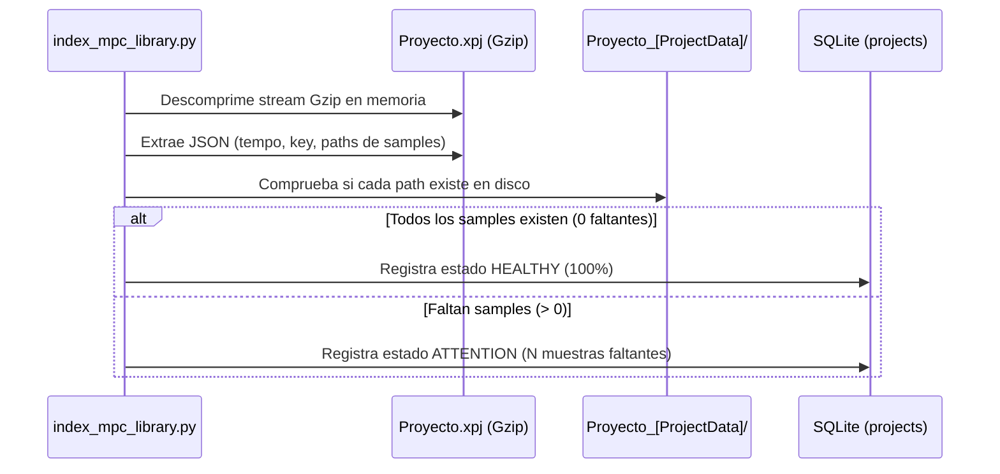

# 🔍 4. Auditoría de Proyectos MPC (.xpj)

Uno de los mayores dolores de cabeza para los beatmakers en Akai MPC es abrir un proyecto antiguo y encontrarse con la temida pantalla de **`Missing Samples`**, donde el proyecto suena a medias porque no encuentra las muestras originales en la tarjeta.

El toolkit incluye un analizador profundo capaz de inspeccionar los proyectos `.xpj` sin necesidad de encender el hardware ni abrir el software MPC.

---

## 🔬 Anatomía de un Archivo `.xpj`

Aunque tiene extensión `.xpj`, internamente es un contenedor comprimido con **gzip** que aloja un archivo JSON estructurado con la configuración completa de la canción:
* Tempo global del proyecto (en formato decimal, ej: `92.0` o `140.0`).
* Clave y tonalidad de la escala.
* Pistas de audio, pistas MIDI y programas asignados a los pads.
* **Diccionario de rutas de samples**: Cada muestra asignada a una pista o pad queda registrada con su atributo `"path"`.

---

## 🛠️ Cómo Funciona la Auditoría Automática

Durante la ejecución de `index_mpc_library.py`:

1. **Descompresión en tiempo de ejecución**: El indexador lee el flujo comprimido mediante `gzip.open` en memoria sin alterar el archivo original.
2. **Extracción de Rutas de Samples**: Busca todos los elementos `"path": "nombre_muestra.wav"` asignados a los pads y descarta referencias a archivos ocultos de macOS.
3. **Comprobación en `_[ProjectData]`**:
   Verifica si la carpeta acompañante `NombreProyecto_[ProjectData]` existe y si cada archivo `.wav` referenciado está presente en ella.
4. **Calificación de Estado**:
   * **`HEALTHY`**: El 100% de los samples referenciados están en su lugar. El proyecto cargará en el MPC sin advertencias.
   * **`ATTENTION`**: Faltan uno o más samples. El catálogo informará exactamente cuántos samples faltan para que puedas corregirlo antes de un show en directo.

---

## 📊 Visualización en el Catálogo Web

En la pestaña **📁 Proyectos MPC (.xpj)** del catálogo interactivo, cada proyecto se presenta en una tarjeta visual con:
* Nombre del proyecto y tamaño del archivo `.xpj`.
* Tempo de reproducción exacto y clave de la sesión.
* Número total de muestras enlazadas.
* Indicador de salud con código de colores (Verde = `HEALTHY`, Rojo = `ATTENTION`).
* Botón **📋 Copiar Ruta Proyecto** para acceder a él al instante.

---

## 💡 Cómo Reparar un Proyecto con Estado `ATTENTION`

Si el catálogo marca que a un proyecto le faltan 3 samples:
1. Conecta la tarjeta al ordenador.
2. Abre la base de datos `mpc_sample.db` o busca en el catálogo los nombres de los samples que faltan.
3. Cópialos directamente a la carpeta `MPC-Sample/Projects/TuProyecto_[ProjectData]/`.
4. Vuelve a ejecutar `./install.sh` (Opción 1).
5. El estado cambiará automáticamente a **`HEALTHY`**.
