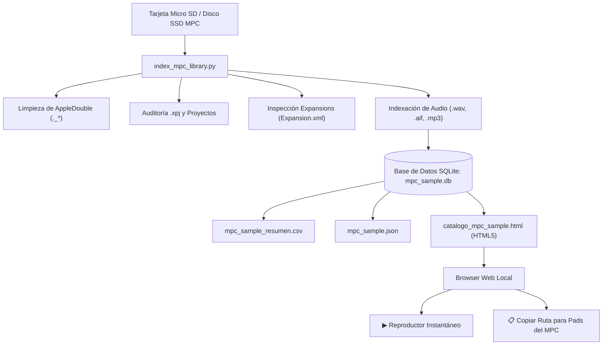

# 🎛️ Bienvenido a la Wiki de Akai MPC Sample Database

**Akai MPC Sample Database & Finder Toolkit** es un ecosistema de código abierto diseñado para maximizar el rendimiento, la velocidad de navegación y la estabilidad de tu librería musical en el hardware **Akai MPC Standalone** (MPC Live, Live II, One, One+, X, X SE, Key 37, Key 61, MPC Studio y MPC Touch).

---

## 📌 ¿Por qué este proyecto?

El hardware Akai MPC en modo Standalone cuenta con una CPU ARM y memoria RAM dedicada (usualmente 2 GB a 4 GB según el modelo). Cuando conectamos tarjetas Micro SD o discos SSD con decenas de miles de samples desordenados o con millones de metadatos residuales del sistema operativo (como los archivos `._*` de macOS), nos encontramos habitualmente con tres problemas críticos:

1. **Lentitud extrema en el Browser del MPC**: La pantalla táctil tarda varios segundos en renderizar carpetas masivas.
2. **Pérdida de Samples en Proyectos (`Missing Samples`)**: Al mover carpetas sin control, los proyectos `.xpj` pierden sus referencias sonoras.
3. **Imposibilidad de preescuchar y catalogar rápidamente**: No existe un buscador rápido en un ordenador portátil para encontrar un bombo específico a 90 BPM en escala Dm sin tener que abrir el DAW completo.

Este toolkit resuelve estos desafíos combinando la potencia de **SQLite 3**, un indexador autónomo en **Python 3** sin librerías externas, y un **Catálogo Visual en HTML5** con preescucha de audio y buscador instantáneo de rutas.

---

## 🗺️ Índice de la Wiki

A continuación tienes acceso directo a todos los módulos y guías del toolkit:

| Módulo | Descripción |
| :--- | :--- |
| **[🚀 1. Instalación y Puesta en Marcha](01-Instalacion-y-Puesta-en-Marcha)** | Requisitos mínimos, clonado del repositorio y ejecución del instalador interactivo en macOS, Linux y Windows. |
| **[📁 2. Organización MicroSD para MPC](02-Organizacion-MicroSD-para-MPC)** | La arquitectura ergonómica recomendada de 7 macro-categorías, formato ExFAT y purga de archivos `._*`. |
| **[🎹 3. Taxonomía y Detección de Audio](03-Taxonomia-y-Deteccion-de-Audio)** | Los 12 tipos de sonido, rangos de BPM (Lo-Fi a DnB), ruedas de armónicos Camelot y cálculo de energía. |
| **[🔍 4. Auditoría de Proyectos (.xpj)](04-Auditoria-de-Proyectos-MPC-(xpj))** | Descompresión gzip, lectura de JSON interno, validación de carpetas `_[ProjectData]` y estados HEALTHY. |
| **[📦 5. Expansiones Oficiales Akai](05-Expansiones-Oficiales-Akai)** | Parseo de `Expansion.xml`, programas `.xpm` / `.pgm`, carátulas gráficas y convivencia con kits de usuario. |
| **[🌐 6. Catálogo Web y Audio Player](06-Catalogo-Web-y-Audio-Player)** | Funcionamiento del catálogo HTML5, solución al sandbox local con el servidor ligero y botón de copiado de rutas. |
| **[📊 7. Consultas Avanzadas SQLite](07-Consultas-Avanzadas-SQLite)** | Consultas SQL prácticas para productores musicales, análisis estadístico y exportación a CSV/JSON. |

---

## 🏗️ Diagrama de Flujo del Ecosistema

---

## 💡 Contribuir o Enviar Sugerencias

Este proyecto está mantenido por **[Astro1Deep](https://github.com/Astro1Deep)** para la comunidad global de productores. Si tienes ideas sobre nuevas reglas de clasificación sonora, soporte para formatos adicionales o mejoras en la interfaz, por favor abre un [Issue o Pull Request en GitHub](https://github.com/Astro1Deep/mpc-sample-database/issues).
