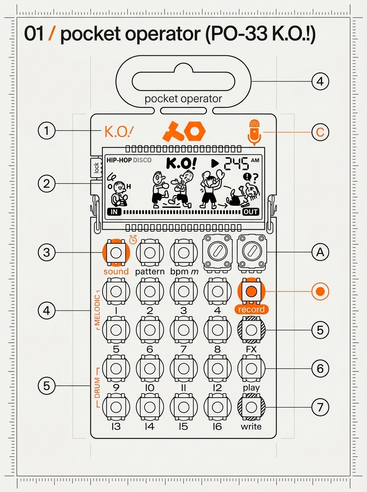
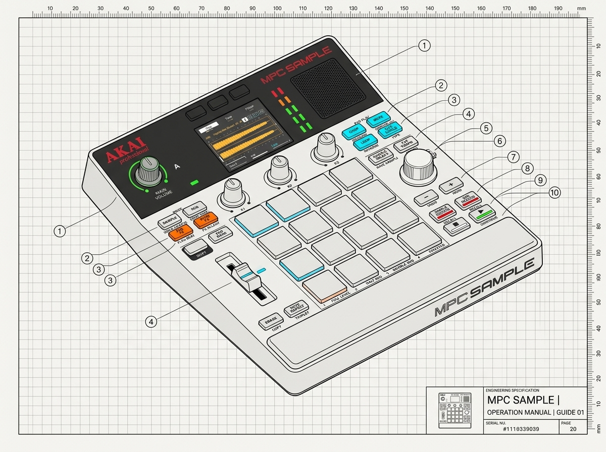
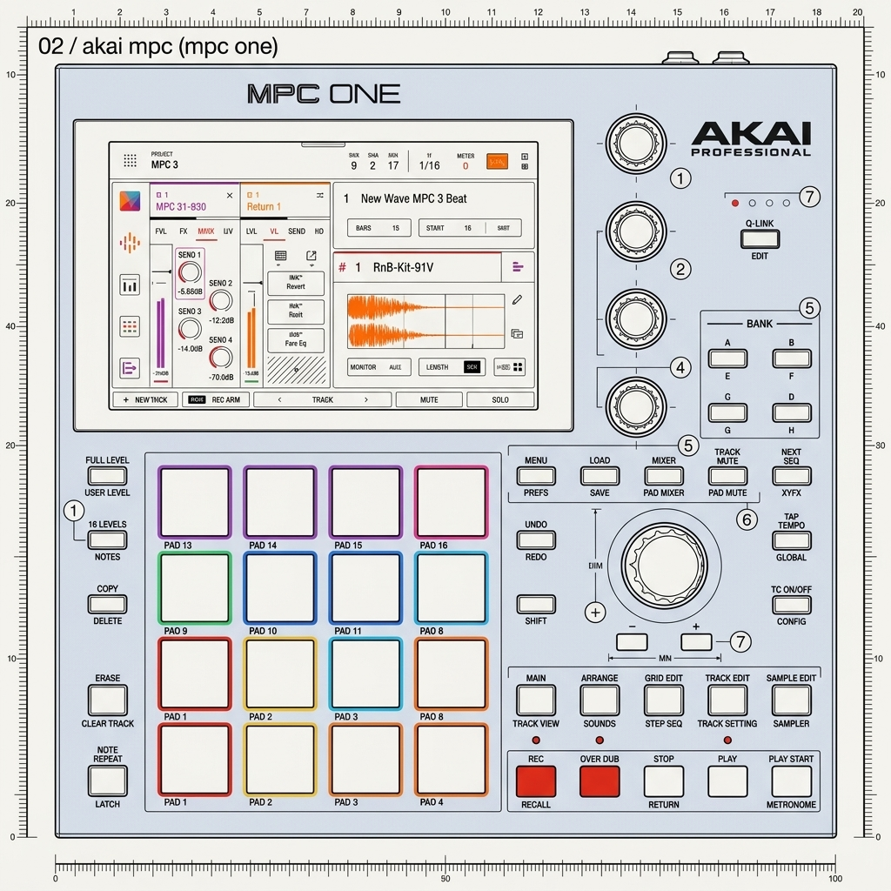
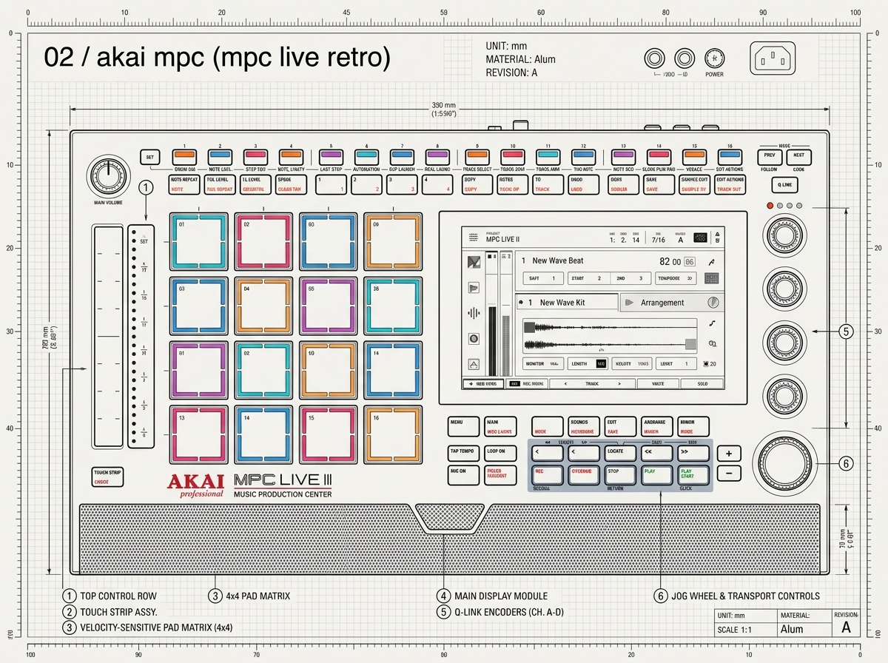
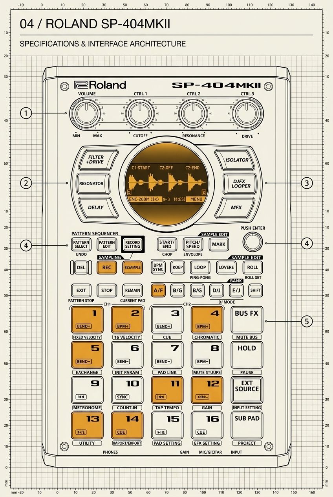
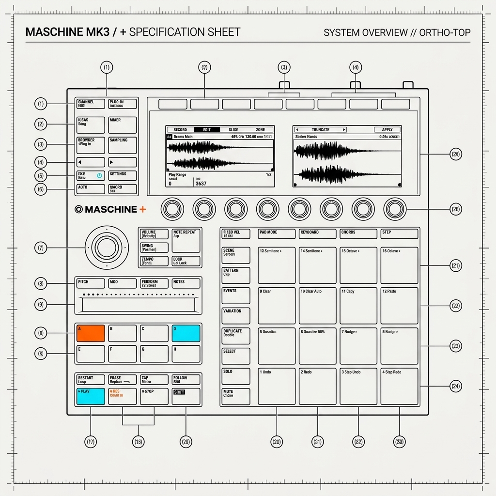
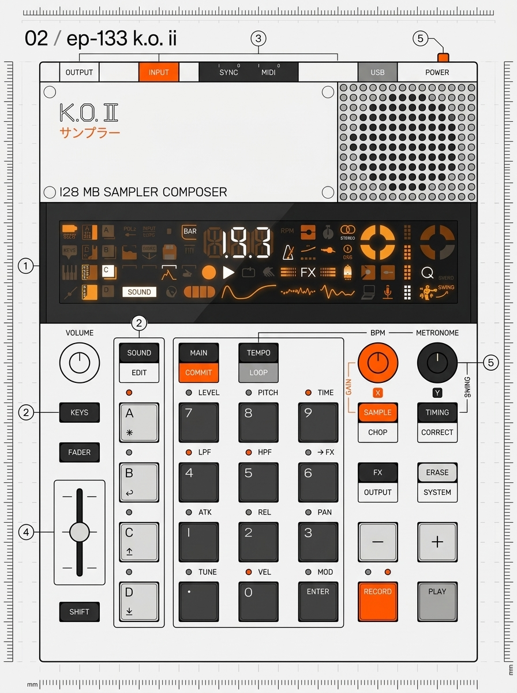
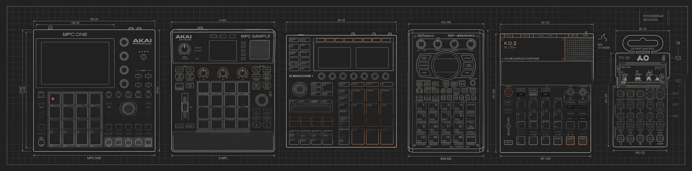
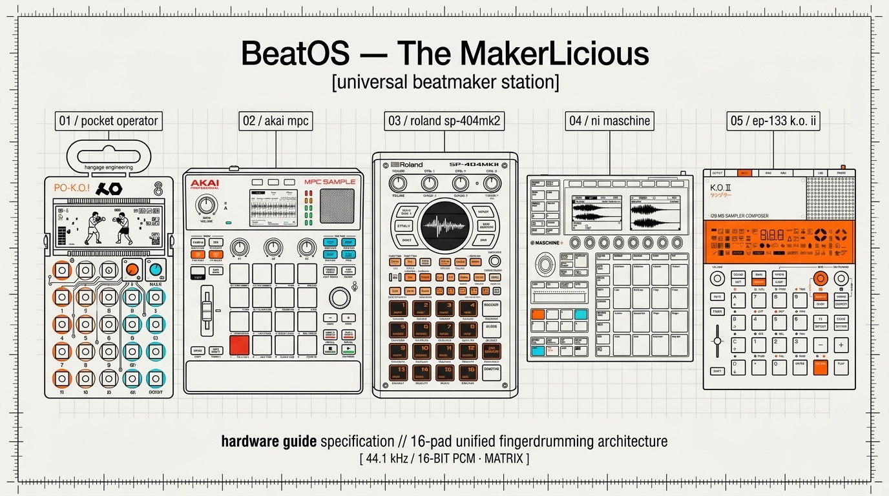

# 16-pad beatmaker kit rack and six sampler export targets

**BeatOS 3.8.0 · English** · [Español / Versión española](../08-Universal-Hardware-Beatmaker-Rack-(MPC-Maschine-SP404-PO33).md) · [Complete English manual](../../en/MANUAL_COMPLETO.md#10-kit-export-workflow) · [Hardware compatibility](../../en/COMPATIBILIDAD_HARDWARE.md)

Build kits by browsing, previewing and assigning loose samples or by importing a supported MPC Drum bank. Each occupied pad can have gain, panning, semitone tune and a **mute/choke group** (0 allows overlap). You can swap pad locations, audition them and export only the **visible 16-pad bank**. Select a target, give your kit a new name and export to `Custom_Kits/<name>/` inside the active library. **MPC** creates a Drum XPM and an AC50/Sample-derived XPJ; **Maschine** creates WAV plus mapping JSON, not MXGRP; **SP-404MKII** exports 16-bit/48 kHz WAV; **SP-404A/SX** exports at most pads 1–12 at 44.1 kHz; **PO-33/PO-133** gets a mono audio reel, not a backup; **EP-133** gets WAV, mapping and a transport ZIP, not a native project. The Universal target runs all six and may abort the bundle if one conversion fails. Follow each device's loading procedure, audition, and save in the native engine.

## Hardware Drafting Blueprints

Authentic orthographic technical drafting illustrations (Teenage Engineering / Dieter Rams manual style) for each supported hardware workstation:

| Station | Hardware | Technical Blueprint (Top-Down) | Transparent Overlays (32-bit PNG) |
| :---: | :--- | :---: | :---: |
| **01** | **Teenage Engineering PO-33 K.O.!** |  | [Black Ink](../../assets/branding/blueprint_transparent_ink_po33.png) · [White Chalk](../../assets/branding/blueprint_transparent_chalk_po33.png) |
| **02A** | **Akai MPC Sample (AC50)** |  | [Black Ink](../../assets/branding/blueprint_transparent_ink_mpc_sample.png) · [White Chalk](../../assets/branding/blueprint_transparent_chalk_mpc_sample.png) |
| **02B** | **Akai MPC One (G2 Cobalt)** |  | [Black Ink](../../assets/branding/blueprint_transparent_ink_mpc_one.png) · [White Chalk](../../assets/branding/blueprint_transparent_chalk_mpc_one.png) |
| **02C** | **Akai MPC Live Retro** |  | [Black Ink](../../assets/branding/blueprint_transparent_ink_mpc_live_retro.png) · [White Chalk](../../assets/branding/blueprint_transparent_chalk_mpc_live_retro.png) |
| **03** | **Roland SP-404MKII** |  | [Black Ink](../../assets/branding/blueprint_transparent_ink_sp404mk2.png) · [White Chalk](../../assets/branding/blueprint_transparent_chalk_sp404mk2.png) |
| **04** | **NI Maschine MK3** |  | [Black Ink](../../assets/branding/blueprint_transparent_ink_maschine.png) · [White Chalk](../../assets/branding/blueprint_transparent_chalk_maschine.png) |
| **05** | **Teenage Engineering EP-133 K.O. II** |  | [Black Ink](../../assets/branding/blueprint_transparent_ink_ep133.png) · [White Chalk](../../assets/branding/blueprint_transparent_chalk_ep133.png) |

### Panoramic Ecosystem Banners
- **Master Widescreen Dark PCB Banner (4128 × 1024)**: 
- **Panoramic 16:9 Drafting Bone White Banner**: 
- **Panoramic Transparent Overlays**: [Black Ink](../../assets/branding/blueprint_transparent_ink_master_banner.png) · [White Chalk](../../assets/branding/blueprint_transparent_chalk_master_banner.png)

---

[English documentation index](../Home_EN.md) · [Installation](../../../GUIA_INSTALACION_EN.md) · [Technical API / SQLite reference](../../en/REFERENCIA_TECNICA.md)
